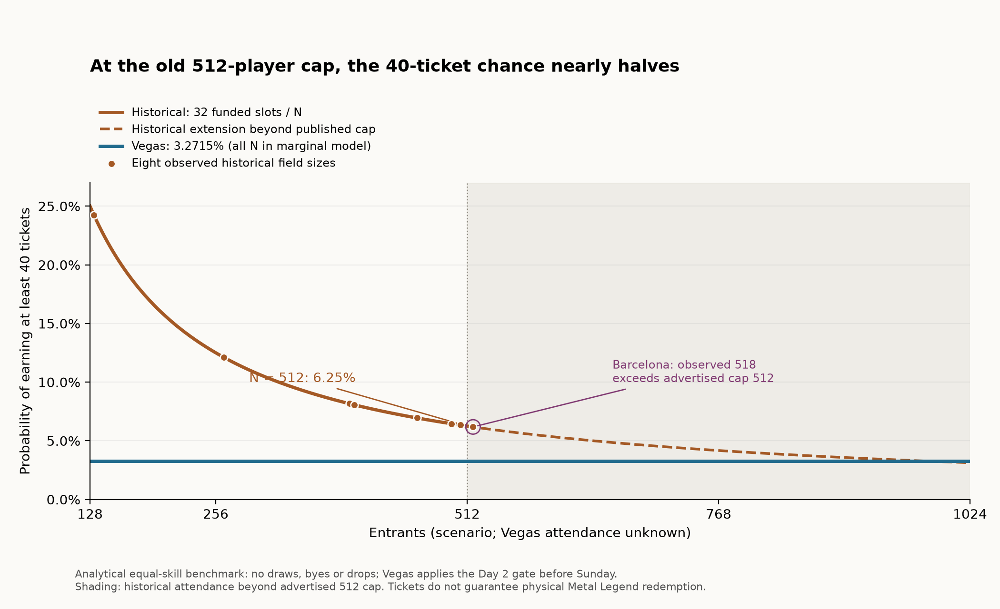
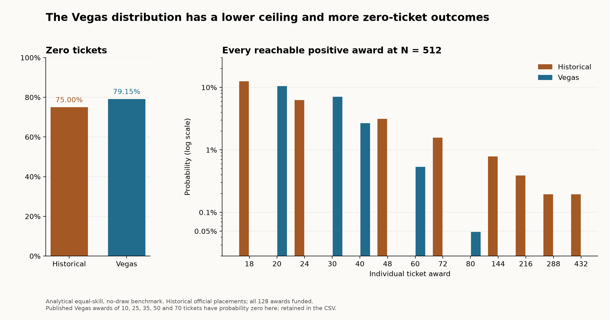
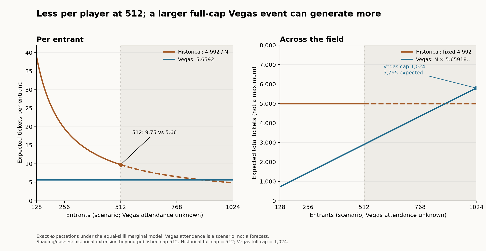
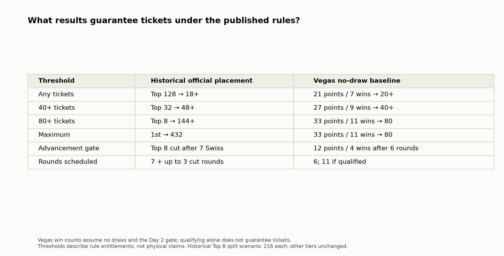
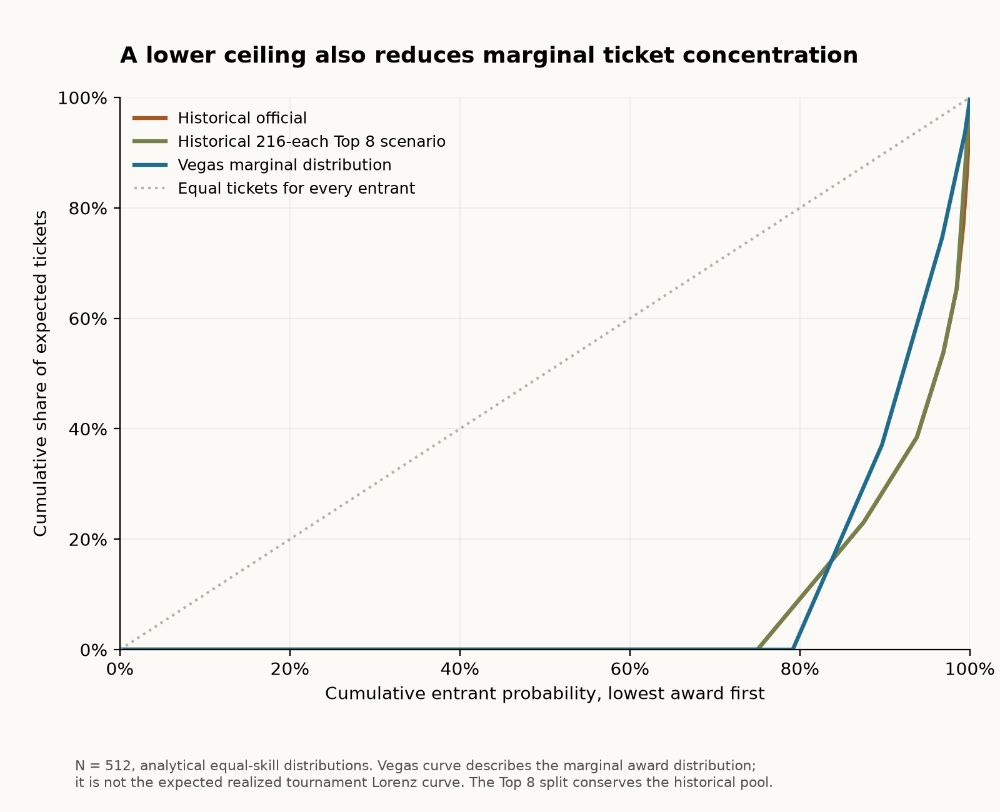

# Phase 3A — Saturday ticket economy, exact analytical benchmark

Implemented and verified 2026-11-25. This stage compares the published historical
Super Saturday Challenge allocation with Convergence Fest Las Vegas Standard
Rebound. Historical evidence, model assumptions and interpretations are separate
below. These calculations describe ticket entitlements, not physical issuance.

## Findings

At the same 512 entrants, an equally skilled player's probability of earning
**40+ tickets falls from 6.25% to 3.271484375%**: a decrease of 2.9785 percentage
points, or 47.65625% relative. Expected tickets per entrant fall from **9.75 to
5.6591796875**, a 41.9571% reduction. Zero-ticket probability increases from
75% to 79.150390625%.

The full-cap comparison answers a different question. At the historical cap of
512, the funded pool is 4,992. At the Vegas cap of 1,024, the analytical expected
total is **5,795**, 16.0857% greater. Capacity doubling can raise the total while
the individual 40-ticket chance falls. **Vegas attendance is unknown; full
capacity is a scenario, not an attendance forecast.**

The historical 40+ chance is higher at all eight recorded Saturday field sizes,
including Barcelona's 518-entry exception. The smallest field, Sydney at 132,
has a 24.2424% historical chance versus the Vegas model's 3.2715% at matched
attendance. The old advertised cap was 512, so extending the historical curve
to 1,024 is an explicitly hypothetical calculation.



## Verified rules and source discrepancies

The eight archived official UVS schedules preserve the historical tiers:

| Final placement | Tickets each | Tickets across the tier |
|---|---:|---:|
| 1 | 432 | 432 |
| 2 | 288 | 288 |
| 3–4 | 216 | 432 |
| 5–8 | 144 | 576 |
| 9–16 | 72 | 576 |
| 17–32 | 48 | 768 |
| 33–64 | 24 | 768 |
| 65–128 | 18 | 1,152 |
| Beyond 128 | 0 | 0 |
| **All funded Top 128 slots** | | **4,992** |

They specify seven Swiss rounds and a Top 8, with advertised capacity 512.
The builder re-parses every archived schedule and checks the unchanged payout
functions. Exact source IDs, URLs and retrieval dates are in
[`data/phase3a/sources.csv`](../data/phase3a/sources.csv); the historical inputs
are [`historical_ticket_economy.csv`](../outputs/tables/historical_ticket_economy.csv).
Missing cut winners remain unknown; this allocation assumes all 128 prizes were
awarded and does not assign unresolved places to identifiable players.

The [official Riot Convergence Fest side-event schedule](https://teamfighttactics.leagueoflegends.com/en-us/news/esports/convergence-fest-side-events-and-the-encore-details/)
specifies six rounds on Saturday, five on Sunday, a **12-match-point Day 2
qualification cut**, no Top Cut, and capacity **1,024**, with 256 seats held for
Regional Championship competitors. No new players enter on Day 2. The complete
published ticket table is:

| Final match points | Tickets | Reachable without draws? | No-draw total wins |
|---|---:|---|---:|
| Below 19 | 0 | Yes | 0–6 |
| 19–20 | 10 | No | — |
| 21 | 20 | Yes | 7 |
| 22–23 | 25 | No | — |
| 24 | 30 | Yes | 8 |
| 25–26 | 35 | No | — |
| 27 | 40 | Yes | 9 |
| 28–29 | 50 | No | — |
| 30 | 60 | Yes | 10 |
| 31–32 | 70 | No | — |
| 33 | 80 | Yes | 11 |

Scoring uses three match points for a win and one for a draw; the baseline has
only wins and losses. The parser preserves every official band, including
bands with zero probability here. Zero probability is a mathematical result
for this baseline, not a claim that the official tier is absent.

**Round discrepancy:** both schedule descriptions retain prize-award references
to Round 10. They conflict with their explicit six-plus-five structure. The
[official organizer announcement](https://x.com/RiotSherman/status/2122889583201591569)
announced the additional eleventh round. The snapshot is checked for the
canonical post URL, author metadata and the explicit statement in its captured
post heading; HTTP 200 alone is insufficient. Its metadata publication time is
2026-11-18T03:08:12Z. The model uses **11 rounds**, consistent with six plus five
and the 33-point ceiling, and rejects an accidental ten-round configuration.

Both new public pages were archived on 2026-11-25 UTC. Their original bytes,
response details, retrieval times, content hashes and URLs are preserved in the
separate [`data/raw/phase3a/retrievals.jsonl`](../data/raw/phase3a/retrievals.jsonl).
[`vegas_rules.json`](../data/phase3a/vegas_rules.json) retains the parsed cells,
full rows, obsolete references and content-verification result. The historical
ledger and original `data/sources.csv` have not been extended or rewritten.

## Mathematical assumptions and derivation

Every player is equally skilled, each played match is won with probability
1/2, and a player's conditional match outcomes are independent. There are no
draws, concessions or drops, and eligible entrants continue. The historical
model makes each final placement slot equally likely for an entrant.

This is an exact calculation **within a marginal mathematical model**, not a
generated joint Swiss tournament. It assigns no byes, models no tiebreakers or
rematch restrictions, and does not enforce finite-field pairing/parity after
qualification. Odd historical fields and a randomly odd Day 2 field would need
byes in a joint tournament; those effects are outside this first benchmark.
Vegas probabilities therefore do not change with N in this model. Do not read
the fractional expected counts as a feasible specific set of tournament results.

### Historical rank slots

For N ≥ 128, sum the funded slots that pay each award and divide by N. Thus:

```text
P(any tickets) = 128/N
P(40+ tickets) = 32/N
P(80+ tickets) = 8/N
E[tickets per entrant] = 4992/N
Total funded tickets = 4992
E[scheduled rounds per entrant] = 7 + (8 + 4 + 2)/N
```

The extra 14 participant-rounds are eight quarterfinalists, four semifinalists
and two finalists. This is scheduled tournament rounds, not elapsed hours or
completed played-match count. The split alternative retains the published
bracket schedule; a split agreement alone does not establish that games were
skipped. Non-ticket promos, qualification benefits and entry costs are not valued.

### Vegas paths, with qualification first

Let K be wins in six Saturday rounds: K ∼ Binomial(6, 1/2). Qualification is
3K ≥ 12, so K ≥ 4. Then:

```text
P(qualified) = [C(6,4) + C(6,5) + C(6,6)] / 2^6 = 11/32
P(not qualified) = 21/32
J | qualified ∼ Binomial(5, 1/2)
P(K=k, J=j) = C(6,k) C(5,j) / 2^11, k=4..6, j=0..5
Final points = 3(K+J) for qualifiers; 3K for nonqualifiers
E[scheduled rounds] = 6 + 5(11/32) = 247/32 = 7.71875
```

Nonqualifiers stop after six rounds, have no Sunday win variable, and receive
zero tickets. There are four nonqualifying count paths and 18 qualifying paths,
all preserved in [`saturday_vegas_paths.csv`](../outputs/tables/saturday_vegas_paths.csv).
[`saturday_stage_probabilities.csv`](../outputs/tables/saturday_stage_probabilities.csv)
contains K, qualification, J conditional on qualification, unconditional J with
an explicit `not_played` outcome, and the final point PMF.

Applying the full official payout function to those paths gives:

```text
E[tickets] = (20×215 + 30×145 + 40×55 + 60×11 + 80×1)/2048
           = 5795/1024 = 5.6591796875
P(40+) = (55 + 11 + 1)/2048 = 67/2048
P(80+) = 1/2048
E[field tickets at N] = N × 5795/1024
```

Expected totals follow from linearity of expectation; independence between
different players is not required. No joint total variance, maximum, quantile
or confidence interval is claimed.

Applying Binomial(11,1/2) to every entrant would incorrectly let nonqualifiers
play Sunday and inflate expected tickets to 7.0751953125. In particular, the
correct seven- and eight-win probabilities are 215/2048 and 145/2048 instead
of 330/2048 and 165/2048. The 40+ probability happens to be unchanged by that
particular error, since nine total wins already require at least four in the
first six. Tests therefore verify the gate and expected value, not just P(40+).

## Complete individual award distribution at N = 512

| Ticket award | Historical official probability | Vegas no-draw probability |
|---:|---:|---:|
| 0 | 384/512 | 1621/2048 |
| 10 | 0 | 0 |
| 18 | 64/512 | 0 |
| 20 | 0 | 215/2048 |
| 24 | 32/512 | 0 |
| 25 | 0 | 0 |
| 30 | 0 | 145/2048 |
| 35 | 0 | 0 |
| 40 | 0 | 55/2048 |
| 48 | 16/512 | 0 |
| 50 | 0 | 0 |
| 60 | 0 | 11/2048 |
| 70 | 0 | 0 |
| 72 | 8/512 | 0 |
| 80 | 0 | 1/2048 |
| 144 | 4/512 | 0 |
| 216 | 2/512 | 0 |
| 288 | 1/512 | 0 |
| 432 | 1/512 | 0 |

Each format's complete PMF, including its zero-probability official tiers, is
exported for every scenario in
[`saturday_ticket_distributions.csv`](../outputs/tables/saturday_ticket_distributions.csv).
Fractions, numerators, denominators, decimal probabilities, expected counts and
expected ticket contributions are explicit. A format's CSV need not include
award values appearing only in the other format's rules.



## Same attendance and published-cap scenarios

The following values use official historical placement awards:

| Metric | Historical, N=256 | Historical, N=512 | Historical, N=1,024† | Vegas, any modeled N |
|---|---:|---:|---:|---:|
| Expected tickets per entrant | 19.5 | 9.75 | 4.875 | 5.6591796875 |
| Expected/funded field tickets | 4,992 | 4,992 | 4,992 | N × 5.6591796875 |
| Zero tickets | 50% | 75% | 87.5% | 79.150390625% |
| Any tickets | 50% | 25% | 12.5% | 20.849609375% |
| 40+ tickets | 12.5% | 6.25% | 3.125% | 3.271484375% |
| 80+ tickets | 3.125% | 1.5625% | 0.78125% | 0.048828125% |
| Maximum individual award | 432 | 432 | 432 | 80 |
| Expected scheduled rounds | 7.0546875 | 7.02734375 | 7.013671875 | 7.71875 |

† Historical N=1,024 exceeds all eight advertised 512 caps and is only a
hypothetical extension. Vegas N=256,512,1,024 are attendance scenarios within
its advertised cap. At those Ns, Vegas expected total tickets are 1,448.75,
2,897.5 and 5,795; expected Day 2 fields are 88, 176 and 352, respectively.

The separate `published-full-caps` scenario compares old N=512 with new N=1,024.
It must not be described as an equal-attendance comparison or evidence of sales.
At these caps, the expected numbers of 40+ recipients are 32 historical versus
33.5 Vegas, while their individual probabilities remain 6.25% versus 3.2715%.

For context only, the equal-attendance ticket-EV curves cross at N≈882.11 and
the 40+ curves at N≈978.15, both beyond the historical advertised cap. At the
hypothetical equal N=1,024, Vegas slightly exceeds the historical 40+ probability.
These crossings do not establish a legally offered historical 1,024-player event.



## Recorded historical attendance, kept distinct from capacities

N is the Phase 2 final-standings entry count, including zero-match rows, not a
nominal capacity or a claim of distinct weekend attendees. The observed field
sizes below govern conditional rank-slot counts; the Vegas column is a matched-N
model, not historical Vegas data.

| Recorded Saturday | Observed N | Historical tickets/entry | Historical 40+ | Historical zero | Vegas expected field tickets at matched N |
|---|---:|---:|---:|---:|---:|
| Atlanta | 392 | 12.7347 | 8.1633% | 67.3469% | 2,218.3984 |
| Sydney | 132 | 37.8182 | 24.2424% | 3.0303% | 747.0117 |
| Vancouver | 264 | 18.9091 | 12.1212% | 51.5152% | 1,494.0234 |
| Utrecht | 505 | 9.8851 | 6.3366% | 74.6535% | 2,857.8857 |
| Hartford | 397 | 12.5743 | 8.0605% | 67.7582% | 2,246.6943 |
| Barcelona | 518 | 9.6371 | 6.1776% | 75.2896% | 2,931.4551 |
| Singapore | 496 | 10.0645 | 6.4516% | 74.1935% | 2,806.9531 |
| Los Angeles | 461 | 10.8286 | 6.9414% | 72.2343% | 2,608.8818 |

Each historical total is the conditional 4,992-ticket pool. **Barcelona's
observed 518 exceeds its archived advertised capacity of 512.** The record is
preserved as an observed source exception; it is not silently clipped, called
hypothetical, or treated as evidence that the published cap was formally raised.
Its reason remains unknown. Utrecht is included because its archived records
were recovered. Unresolved individual cut placements remain unresolved.

The comparison CSV has 12 attendance scenarios × two historical allocations =
24 rows. The Vegas metrics are repeated alongside each historical alternative
for direct comparison; these are alternatives, not additive events. The long
PMF CSV emits Vegas once per attendance scenario to avoid duplicate totals.

## Guaranteed thresholds, concentration and the Top 8 split

Under historical official rules, Top 128 guarantees at least 18 tickets, Top 32
at least 48, and Top 8 at least 144. Under the Vegas no-draw baseline, earning
tickets requires at least seven total wins (21 points); 40+ requires nine wins
(27 points), and 80 requires a perfect 11 wins. Qualification alone is no prize
guarantee: even 6–0 Saturday followed by 0–5 Sunday leaves 18 points and zero.
Among qualifiers, P(40+) is 67/704 ≈9.5170%; this conditional chance must not be
substituted for the 3.2715% probability at event entry.



Historical concentration is a direct funded-slot calculation: the Top 8 take
1,728/4,992 = **34.6154%** of the pool, Top 16 take 46.1538%, Top 32 take 61.5385%,
and Top 64 take 76.9231%. The reported **216-each Top 8 scenario** redistributes
that same 1,728 among eight players. It reduces the individual ceiling to 216
and changes concentration within the cut, while leaving the pool, mean, zero
probability, 40+ probability and 80+ probability unchanged. No event-specific
split agreement is newly verified here.

At N=512 the marginal ticket Gini is 0.860558 historical official versus
0.825423 Vegas. The upper 1% of the respective marginal award distributions
account for 26.3077% versus 9.3115% of expected tickets; fractional mass within
ties is allowed. These are **marginal distribution** summaries. The Vegas Gini
and Lorenz curve are not expected realized-field statistics: no joint field
allocation has been generated. Lower concentration does not imply a higher
chance of earning 40 tickets; the mean and maximum also change.



## Interpretation for the research question

The strongest supported statement is that **an equally skilled entrant has a
harder single-event path to 40 tickets under the new structure, at the old cap
and at every recorded historical Saturday attendance**. The path also extends
into Sunday for qualifiers, with 7.71875 expected scheduled rounds at entry,
compared with 7.02734 at historical N=512. This is not yet a probability of
earning a Metal Legend over a full weekend, a participant-hour calculation,
or a valuation of other rewards. Having 40 tickets alone does not establish
inventory, badge eligibility, redemption availability or physical receipt.

The lower Vegas ceiling also sharply reduces the modeled 80+ chance: 1.5625%
historical at 512 versus 0.048828125% Vegas, a 96.875% relative reduction. It is
therefore possible for a larger Vegas event to produce more tickets overall
while leaving most individual entrants with fewer tickets and a lower chance
of crossing the 40-ticket threshold. The model does not establish behavioral
responses, intent, coordination or misconduct.

## Qualitative caveats and next work

The research context is that the historical Saturday Challenge overlapped the
main Regional Qualifier, preventing concurrent main-event participation. At
Vegas, Regional Championship players eliminated Friday can enter Saturday's
Rebound; the official event description explicitly invites them and reserves
256 seats for RC competitors. This **may** strengthen the Vegas field relative
to the historical side events. It is not a measured skill adjustment here.
Equal-skill entrant probabilities cannot predict the chance of a particular
competitive player against that field. Stuttgart Nation Clash may be a useful
future observational comparator; no Stuttgart data were collected in this stage.

A next, separately specified stage could add exact win/draw/loss point paths
through the same point-based qualification and payout functions. It should
test stage- and record-dependent draw sensitivities, reconcile scoring and
eligibility, and preserve this zero-draw baseline. Historical Saturday Round 7
draws were partly shaped by placement/cut incentives; do not automatically
transfer that empirical rate to Vegas's match-point prizes and two-stage gate.
The historical records do not establish the motive of every individual draw.

Only after that sensitivity should finite-field byes/pairings, actual skill
differences and weekend time/conflict constraints be modeled as separately
labeled assumptions. No Monte Carlo, Swiss simulator, ratings distribution,
coordinated ODE model or video script is implemented here.

## Files and reproduction

All calculations and tests use the Python standard library and exact
`fractions.Fraction` arithmetic; decimals in CSVs are display conveniences.
Reusable rules and paths are in `models/saturday_analytical.py`; the independent
Vegas point lookup accepts draw-accessible points even though baseline paths
do not create draws. The module CLI is additive and leaves the historical CLI
and payout functions unchanged.

```sh
# Offline after the included official snapshots are present:
PYTHONPATH=src python3.12 -m riftbound_tickets.phase3a build
PYTHONPATH=src python3.12 -m riftbound_tickets.phase3a audit
python3.12 scripts/validate_phase3a.py

# Optional figures; use the existing environment or create it from pinned deps:
python3.12 -m venv .venv-figures
.venv-figures/bin/python -m pip install -r requirements-figures.txt
PYTHONPATH=src .venv-figures/bin/python -m riftbound_tickets.phase3a figures

# Optional public-source refresh only; appends snapshots, never edits old ones:
PYTHONPATH=src python3.12 -m riftbound_tickets.phase3a collect --refresh
# Review any rule changes before rebuilding/reinterpreting outputs.
```

Primary tables are `saturday_analytical_comparison.csv` and
`saturday_ticket_distributions.csv`. Additional `saturday_*` tables preserve
stages, paths, payout thresholds and Lorenz breakpoints. The analytical report
records input, output and code hashes; its audit independently recalculates all
six tables and verifies the isolated source objects. Figure rendering writes
five SVG/PNG pairs plus an input/code/image hash manifest; it never fetches data.
The images were rendered with pinned Matplotlib and visually reviewed.

### Verification actually executed

The complete existing offline suite and new deterministic tests were executed
on 2026-11-25: **80 tests passed** (55 existing plus 25 new). The mandated commands
`cli build`, `cli verify`, `cli audit`, and `cli validate-pilot` all exited zero,
as did `cli audit-phase2` and the new Phase 3A build and audit. Fresh command
timestamps, exit codes and log hashes are recorded in
[`saturday_execution_validation.json`](../outputs/tables/saturday_execution_validation.json),
with complete logs under `outputs/phase3a/validation/`.

Tests cover exact normalization, gate order, payout boundaries, unreachable
bands, zero awards, historical pool conservation and split invariance,
attendance labels, expected values/rounds, source-content verification and an
independent exhaustive binary-path oracle. No reference answer is inserted
as an implementation output.

The preservation check fingerprints **615 pre-existing historical files**,
including all raw evidence, the historical ledger and source index, processed
records, Phase 2 tables/reports, construction witnesses, figures and report
documentation. All remain byte-for-byte unchanged. The existing Phase 2
integration test harness now performs its same rebuild/audit checks inside
temporary outputs with original inputs, rather than rewriting archived reports
whose inventory would expand when new code files appear. No historical report
was restored after a failed data comparison. The general legacy validation
report is freshly regenerated to inventory the additive modules; it is not a
Phase 2 archival data artifact. New sources and calculations have their own
ledger, source index, provenance and audit.
