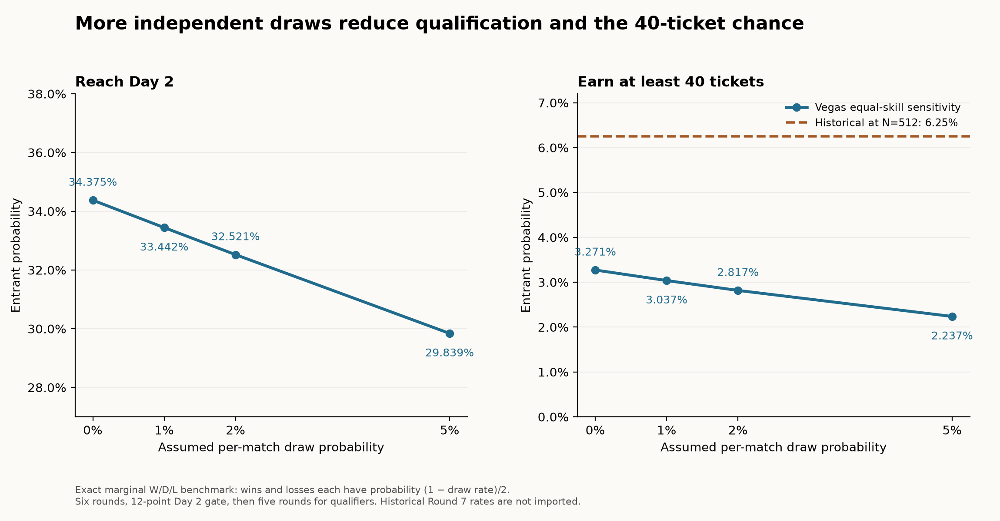
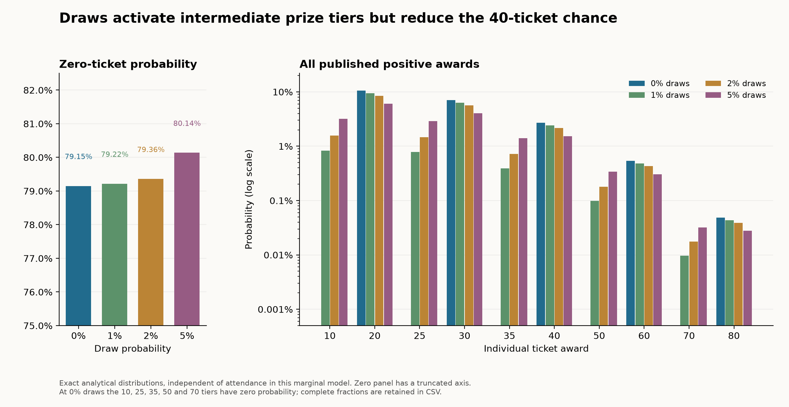
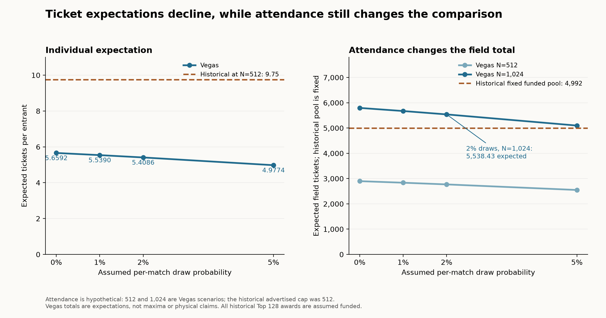
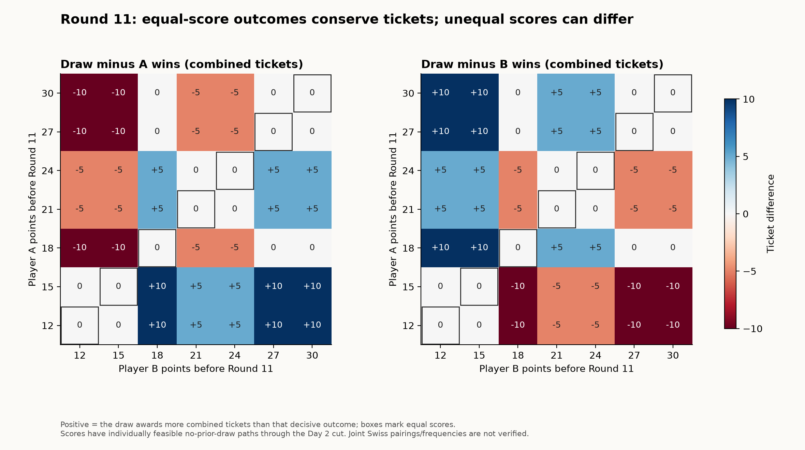
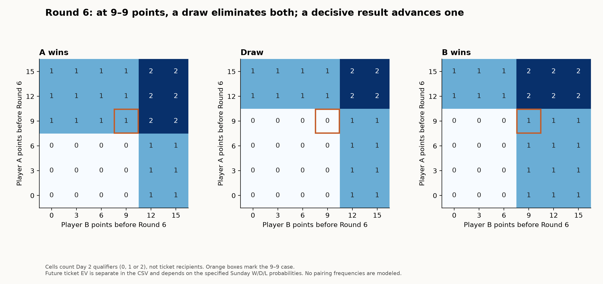

# Phase 3B — Draw sensitivity and strategic match outcomes

Implementation date: 2026-11-25. This adds exact independent-draw sensitivities
and conditional local outcome matrices to the preserved
[Phase 3A Saturday benchmark](PHASE3A_SATURDAY_COMPARISON.md). It does not model
players choosing outcomes or predict observed Vegas performance. Published
entitlements remain distinct from verified physical ticket issuance.

## Findings

| Per-match draw probability | Day 2 qualification | Chance of 40+ tickets | Expected tickets / entrant | Expected tickets, N=512 | Expected tickets, N=1,024 |
|---:|---:|---:|---:|---:|---:|
| 0% | 34.3750% | 3.2715% | 5.659180 | 2,897.50 | 5,795.00 |
| 1% | 33.4425% | 3.0370% | 5.539002 | 2,835.97 | 5,671.94 |
| 2% | 32.5211% | 2.8167% | 5.408623 | 2,769.21 | 5,538.43 |
| 5% | 29.8390% | 2.2368% | 4.977423 | 2,548.44 | 5,096.88 |

At 2% draws, the modeled 40-ticket chance is **13.9015% lower than Vegas's
draw-free benchmark**, and expected tickets per entrant are **4.4274% lower**.
At equal N=512, historical Saturday's 40+ chance is 6.25% and its funded pool is
4,992: the 2% Vegas scenario has a **54.9328% lower 40+ chance** and **44.5269%
fewer expected tickets per entrant**. These differences are model comparisons,
not an estimate of historical tickets lost to draws or a causal event study.

The two local-outcome findings are distinct:

- **Round 11:** every individually feasible equal-score, no-prior-draw case
  has identical combined tickets under a draw or either decisive result. Unequal
  scores can produce different totals. Across this score grid, a draw's combined
  award always equals the average of the two decisive-result totals. The number
  reaching 40 tickets can still change.
- **Round 6:** at 9–9 points, a draw eliminates both players, while a decisive
  result advances its winner. At higher scores both may qualify under all
  outcomes, but their future expected awards can differ. Qualification alone
  does not guarantee a prize.



## Verified rules and preserved sources

The builder reuses the existing archived
[official Riot Convergence Fest schedule](https://teamfighttactics.leagueoflegends.com/en-us/news/esports/convergence-fest-side-events-and-the-encore-details/)
and [official eleventh-round announcement](https://x.com/RiotSherman/status/2122889583201591569).
It verifies their hashes and captured content through the unchanged Phase 3A
source code, then re-parses all eight historical official payout schedules.
No live source refresh occurred in Phase 3B. This verifies the preserved rules,
not whether a later organizer revision exists.

Vegas uses six Saturday rounds, at least 12 match points to advance, and five
Sunday rounds for qualifiers; there are **11 rounds** in total. Scoring is
3/1/0 for wins/draws/losses. The preserved schedule still has two references
to awarding prizes after Round 10; its explicit six-plus-five structure and
the separate eleventh-round announcement govern this analysis. No new players
enter Day 2, and the advertised Vegas cap is 1,024.

| Final match points | Published tickets |
|---|---:|
| 0–18 | 0 |
| 19–20 | 10 |
| 21 | 20 |
| 22–23 | 25 |
| 24 | 30 |
| 25–26 | 35 |
| 27 | 40 |
| 28–29 | 50 |
| 30 | 60 |
| 31–32 | 70 |
| 33 | 80 |

All official bands remain in the payout function. With positive draw
probability, the 10, 25, 35, 50 and 70 awards have positive probability here.
**32 points remain impossible** under eleven 3/1/0 results: compared with eleven
wins at 33 points, a draw removes two points and a loss removes three, so a
one-point deficit cannot occur. The table's 70-ticket band is reached at 31.
Likewise, 17 after six rounds and 14 after five are impossible. These zeros
are structural model results, not missing evidence.

The reproducible source review is
[`data/phase3b/source_review.json`](../data/phase3b/source_review.json). It records
the full point tiers, round discrepancy, announcement-content verification,
and the original URLs, retrieval dates, raw paths and hashes. The original
Phase 3A source index and ledger remain unchanged:
[`data/phase3a/sources.csv`](../data/phase3a/sources.csv) and
[`data/raw/phase3a/retrievals.jsonl`](../data/raw/phase3a/retrievals.jsonl).

## Exact model and qualification gate

For draw probability d, p(win)=p(loss)=(1−d)/2 and p(draw)=d. Four exact rational
values are evaluated: 0, 1/100, 1/50 and 1/20. Outcomes are independent for a
player, with a constant rate across rounds and records. Eligible players
continue; drops, concessions, byes, skill variation, rematch constraints and
state-dependent strategic choices are not assigned in this benchmark.

The one-match points-generating polynomial is:

```text
G(z) = p(loss) + p(draw) z + p(win) z^3
F_r(s) = coefficient of z^s in G(z)^r
F_0(0) = 1
F_(r+1)(s) = p(loss) F_r(s) + p(draw) F_r(s−1) + p(win) F_r(s−3)
```

Dynamic programming computes all coefficients with `fractions.Fraction`.
Qualification is evaluated after six rounds:

```text
q = sum(F_6(s), s ≥ 12)
P(final points = t)
  = F_6(t) for eliminated states t < 12
    + sum(F_6(s) F_5(t−s), s ≥ 12)
```

Nonqualifiers stop at their Day 1 points, have no Sunday points variable and
play six modeled rounds. Qualifiers add five Sunday rounds. Three wins and
three draws make 12 points and qualify: a four-win shortcut would be wrong
once draws exist. Applying the official payout lookup T(t) gives:

```text
P(tickets = a) = sum(P(final points = t), T(t)=a)
E[tickets per entrant] = sum(a × P(tickets=a))
E[field tickets at N] = N × E[tickets per entrant]
E[Day 2 entrants] = N × q
E[entrants earning 40+] = N × P(tickets ≥ 40)
E[rounds played per entrant] = 6 + 5q
```

Counts remain fractional expectations throughout. Decimal rendering in the
report and CSV is for convenience; exact fractions drive every calculation.
Linearity of expectation does not require independence between different
players. These totals are **expectations, not theoretical maxima**. No joint
tournament distribution, interval for total tickets or probability of a given
pairing is calculated. Scheduled rounds equal played rounds within this
no-bye/full-continuation marginal model; this is not an elapsed-time estimate.

### Additional entry-level quantities

| Draw rate | Zero tickets | Any tickets | Expected Day 2 entrants at N=1,024 | Expected 40+ entrants at N=1,024 | Expected rounds / entrant |
|---:|---:|---:|---:|---:|---:|
| 0% | 79.1504% | 20.8496% | 352 | 33.5 | 7.718750 |
| 1% | 79.2175% | 20.7825% | 342.451119 | 31.098792 | 7.672125 |
| 2% | 79.3586% | 20.6414% | 333.016318 | 28.842993 | 7.626056 |
| 5% | 80.1367% | 19.8633% | 305.551303 | 22.905212 | 7.491950 |

At N=512 the two participant-count columns are exactly half. For example, the
2% scenario expects 166.508159104 qualifiers and approximately 14.421496687
40+ recipients. These are not rounded into fictitious actual people.
The expected round count falls as more entrants fail the cut; this does not
mean that qualifiers have a shorter eleven-round event.

The full 0–33 final-points PMF and every official ticket-award tier are in
[`saturday_draw_final_points.csv`](../outputs/tables/saturday_draw_final_points.csv)
and [`saturday_draw_ticket_distributions.csv`](../outputs/tables/saturday_draw_ticket_distributions.csv).
Day 1 points, conditional/unconditional Day 2 points, an explicit `not_played`
mass, and all positive aggregate point paths are also exported. No Monte Carlo
or random seed is used.



## Historical Saturday comparison and attendance

The existing official historical placement model is reused unchanged:
funded tickets=4,992, expected tickets/entry=4,992/N, P(any)=128/N,
P(40+)=32/N and P(80+)=8/N for N≥128. The historical Top 8 split is retained
as a separate ticket-conserving alternative; it changes individual awards,
not the pool or these threshold probabilities. Historical empirical draw
rates are not inserted into this placement-slot model.

At equal N=512 all four Vegas draw scenarios have lower expected tickets
per entrant and lower P(40+) than historical Saturday. The same holds at all
eight observed historical field sizes (132–518). The comparison CSV reuses
all Phase 3A attendance labels, including:

- Equal-attendance 256 and 512, within both advertised caps.
- Equal-attendance 1,024 as a **hypothetical historical extension beyond its
  advertised 512 cap**. At this N, historical P(40+)=3.125%; Vegas is slightly
  above it at 0% draws and below it in the 1%, 2% and 5% scenarios.
- Each recorded historical Saturday field size, with Vegas at a matched
  hypothetical N. Barcelona's observed 518 against an advertised 512 is
  retained as an unexplained source exception, not clipped or relabeled.
- A separate published-cap comparison, old N=512 versus Vegas N=1,024.

Vegas expected totals at N=1,024 exceed the historical funded pool of 4,992
in each evaluated scenario, including 5% draws at 5,096.88. At matched N=512
they are all below it. **Neither capacity nor these expectations establishes
actual Vegas attendance.** The historical pool is conditional on all Top 128
positions being awarded; missing cut winners and physical claims remain
unresolved. The separate allocation alternatives must not be added together.

[`saturday_draw_historical_comparison.csv`](../outputs/tables/saturday_draw_historical_comparison.csv)
has 96 rows: four draw scenarios × 12 attendance comparisons × two historical
allocations. All original historical metrics, field-size provenance and cap
qualifications remain visible.



## Round 11: draw versus each decisive outcome

The matrix starts before the final round, with no previous draws. Individually
feasible scores for a player who passed Day 1 are **12, 15, 18, 21, 24, 27, 30**.
The Round 6 gate excludes lower ten-round scores from an actual Day 2 path.
For starting points (a,b), outcomes are:

```text
draw:  (a+1, b+1)
A win: (a+3, b)
B win: (a, b+3)
```

The CSV evaluates T for each player, the combined award, earning/40+/80+
recipient counts, and signed draw-minus-decisive differences. It contains all
49 ordered score pairs × three outcomes = 147 terminal rows. Draw-minus-A-win,
draw-minus-B-win and A-win-minus-B-win are explicit columns. Positive draw
differences mean more combined tickets under that draw than under the named
decisive result; no likelihood is assigned to those alternatives.

### Equal-score cases

| Starting points each | Draw: A+B tickets | A wins: A+B tickets | B wins: A+B tickets | Combined tickets, every outcome |
|---:|---:|---:|---:|---:|
| 12 | 0+0 | 0+0 | 0+0 | 0 |
| 15 | 0+0 | 0+0 | 0+0 | 0 |
| 18 | 10+10 | 20+0 | 0+20 | 20 |
| 21 | 25+25 | 30+20 | 20+30 | 50 |
| 24 | 35+35 | 40+30 | 30+40 | 70 |
| 27 | 50+50 | 60+40 | 40+60 | 100 |
| 30 | 70+70 | 80+60 | 60+80 | 140 |

All seven preserve the same combined amount. At 18–18, drawing creates two
positive-award recipients instead of one. At **24–24, a draw pays 35 each and
neither reaches 40**, while a decisive result pays 40 and 30 and one reaches
40. Constant combined tickets do not imply constant individual success.

### Unequal-score cases and the fair-result midpoint

Of 21 unordered unequal-score pairs, **16 have different combined totals across
outcomes**, while five also conserve the total. For example:

| Starting A,B points | Draw combined | A wins combined | B wins combined |
|---|---:|---:|---:|
| 18,21 | 35 | 40 | 30 |
| 21,24 | 60 | 60 | 60 |
| 12,30 | 70 | 60 | 80 |

On this score grid, combined draw-minus-decisive differences range from −10 to
+10. The published lookup satisfies the exact identity
`2 T(s+1) = T(s) + T(s+3)` at every selected starting score s. Adding it for
both players proves:

```text
draw combined tickets = (A-win combined tickets + B-win combined tickets)/2
```

Thus, for these no-prior-draw starting scores, a draw and a **50/50 decisive
result** have the same expected combined tickets even when the realized
decisive outcomes differ. This does not extend automatically to scores
containing earlier draws, skill-asymmetric win probabilities, recipient-count
thresholds, or the Round 6 qualification gate. It also does not contradict the
whole-event independent-draw sensitivity, which changes the earlier point
distribution and qualification mass as well as the terminal score residues.



**Feasibility limit:** scores have individually legal no-prior-draw paths that
pass the cut. The matrix does not establish that two such paths can be paired
in a particular finite Swiss field. For example, the 30–30 cell is a conditional
payout identity; it does not demonstrate that two 10–0 players can meet in an
actual 1,024-player eleven-round Swiss. No cells are weighted as likely actual
matchups, and no field-wide strategic ticket total is inferred from the grid.

## Round 6: qualification and Sunday expected awards

Before Round 6, no-prior-draw scores are **0, 3, 6, 9, 12, 15**. The same three
point updates are applied, then qualification is checked against 12 points.
Immediate qualifiers and conditional future ticket EV use separate columns:

```text
E[future tickets | post-Round-6 points s]
  = 0, if s < 12
  = sum(F_5(j) T(s+j)), if s ≥ 12
```

This future value is calculated for each of the four specified Sunday draw
rates, conditional on the locally imposed Round 6 outcome. The matrix does
not weight that local outcome by the scenario draw probability or model a
choice to draw. It contains 36 ordered pairs × three outcomes × four future
scenarios = 432 rows. Combined terminal-award fields are blank for these rows;
Round 11 rows instead leave qualification/future-EV fields blank.

| Starting A,B points | Qualifiers if draw | Qualifiers if A wins | Qualifiers if B wins |
|---|---:|---:|---:|
| 9,9 | 0 | 1 | 1 |
| 9,12 | 1 | 2 | 1 |
| 12,12 | 2 | 2 | 2 |
| 15,15 | 2 | 2 | 2 |

At 9–9, a draw yields zero future tickets because neither qualifies. With
zero future draws, either decisive result advances one player at 12 points
whose future expected award is **12.1875**, not a guaranteed prize. At 2%
future draws, that conditional expected award is **12.166941766**. Even an
18-point qualifier can finish at 18 with five losses and earn zero.

Qualification can stay unchanged while future EV changes:

| Starting scores | Assumed future draws | Draw combined future EV | Either decisive combined future EV |
|---|---:|---:|---:|
| 12,12 | 0% | 35.9375 | 35.9375 |
| 12,12 | 2% | 34.819369865 | 35.892926822 |
| 15,15 | 0% | 60.625 | 60.625 |
| 15,15 | 2% | 59.363950634 | 60.574568628 |

The zero-future-draw equalities follow from the terminal midpoint identity
after adding multiples of three. Future draws introduce other score residues,
so that identity need not persist. These are descriptive point/payout effects.
No prize-sharing agreement contingent on concessions is modeled, and this
report makes no assertion that any particular intentional-draw arrangement is
permitted by tournament policy.



## Interpretation and unresolved assumptions

The four rates are hypothetical sensitivities, not forecasts or fitted Vegas
draw rates. Historical Saturday Round 7 draws were partly influenced by
placement and cut incentives; Vegas uses match-point prizes and a different
qualification gate. The historical source flags do not identify every player's
intent, and its Round 7 rate is not automatically transferable. The local
matrices describe consequences conditional on outcomes, not a behavioral model
of when players draw, concede, continue, split prizes or coordinate.

The assumptions that could materially change results include actual attendance,
finite-field byes and score-group pairing, drops, field strength, unequal win
probabilities, and draw probabilities varying by round or record. Historical
Saturday overlapped the main RQ; Vegas can include Friday-eliminated RC players,
so its pool may differ in strength. This remains a qualitative caveat. The
four-scenario marginal model imposes no simultaneous joint Swiss feasibility.

The 40-ticket threshold measures an entitlement amount. Actual physical claims,
Metal Legend inventory, badge restrictions, redemption and ticket ownership
remain separate questions. Existing historical exceptions—including Barcelona's
cap mismatch, incomplete Top 8 brackets, Atlanta's roster-only row and Hartford's
missing match evidence—remain unchanged in the archival exports.

The recommended next analytical step is a small, explicitly specified
stage-/record-dependent draw sensitivity, with bounds and finite-field
pairing/bye assumptions reviewed before producing tournament forecasts. Then
source the remaining like-for-like Friday/Sunday comparisons and weekend time
constraints. No weekend ODE economics, coordinated pooling model, ratings,
full Swiss simulator or video script was started in this phase.

## Reproduction and validation

Core calculations use the standard library only. `models/saturday_draws.py`
contains the exact DP, gated paths, future-EV lookup and local matrices. It
reuses the unchanged `VegasRules` and payout lookup. The standalone Phase 3B
CLI writes only new files; existing historical and Phase 3A modules are intact.

```sh
PYTHONPATH=src python3.12 -m riftbound_tickets.phase3b build
PYTHONPATH=src python3.12 -m riftbound_tickets.phase3b audit
python3.12 scripts/validate_phase3b.py
# Optional figure rendering in the existing pinned environment:
PYTHONPATH=src .venv-figures/bin/python -m riftbound_tickets.phase3b figures
```

The seven CSVs comprise eight main scenario/attendance rows, 44 ticket PMF rows,
136 final-point rows, 579 local outcome rows, 96 historical comparisons, 328
positive point paths and 208 stage-point rows. All complete PMFs retain true
zero probabilities. Output/code/input hashes are in `saturday_draw_report.json`;
the audit recomputes all tables, verifies sources and figure hashes, and checks
preservation. Five SVG/PNG pairs were rendered with the existing pinned
Matplotlib environment and visually reviewed.

Fresh execution outcomes are recorded in
[`saturday_draw_execution_validation.json`](../outputs/tables/saturday_draw_execution_validation.json)
and logs under `outputs/phase3b/validation/`. The runner executes the full test
suite, all five required historical commands, Phase 2 and Phase 3A audits, and
the new Phase 3B build/audit without rerunning older execution-log writers.
Tests include an independent multinomial-count oracle, exact normalization,
point-based early elimination, all payout thresholds, zero-draw reproduction,
fractional expectations, terminal midpoint identities and Round 6 effects.

**Actually executed on 2026-11-25 America/Chicago (2026-11-26 UTC): 113 tests
passed**, comprising the 80 existing tests and 33 new tests. All nine recorded
commands exited zero, including the required `unittest`, `cli build`,
`cli verify`, `cli audit` and `cli validate-pilot`, plus the Phase 2/3A audits
and Phase 3B build/audit. All 750 protected files remained byte-identical,
and the figure/source/hash recalculation audit passed.

`data/phase3b/preserved_artifacts.json` fingerprints **750 pre-existing files**
from base commit `a423400`, covering all tracked data, raw captures, outputs
(including previous execution logs/reports), source code, existing tests/runners
and research documents except the authorized roadmap/changelog updates. The
general `outputs/tables/validation_report.json` remains a current-code inventory
and is allowed to add the new module hashes; it is not a historical data
revision. README, Makefile, roadmap and changelog are the intended existing-file
updates. No previous Phase 2/3A data, source code, figures or reports are replaced.
