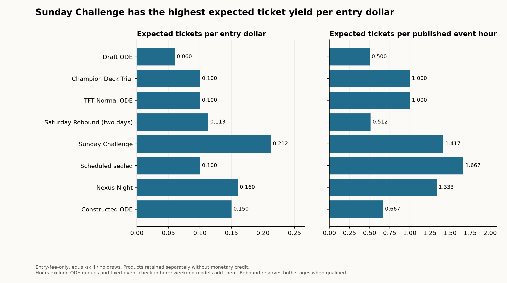
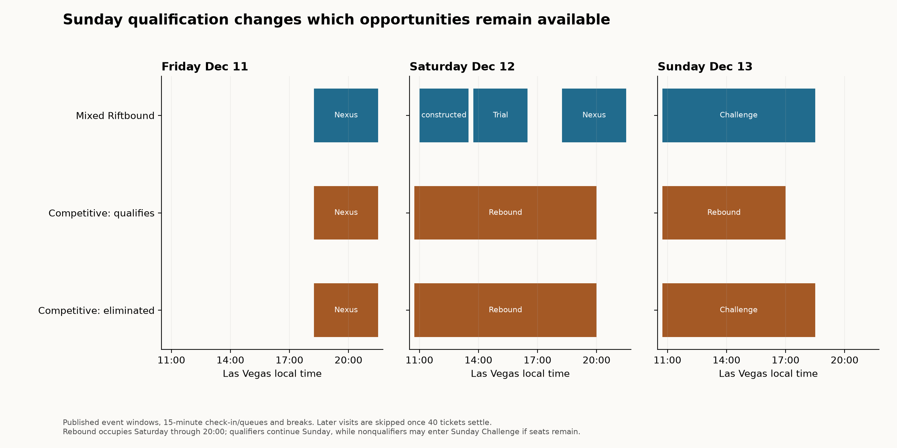
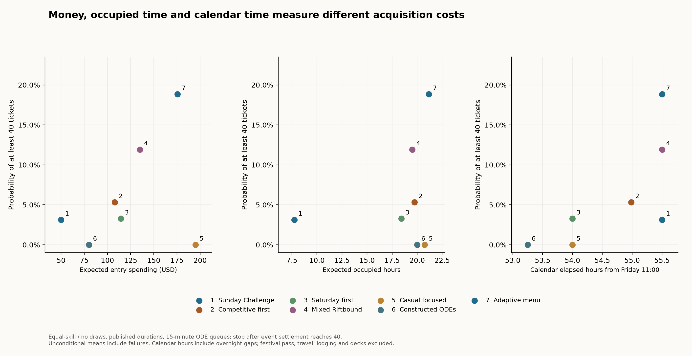
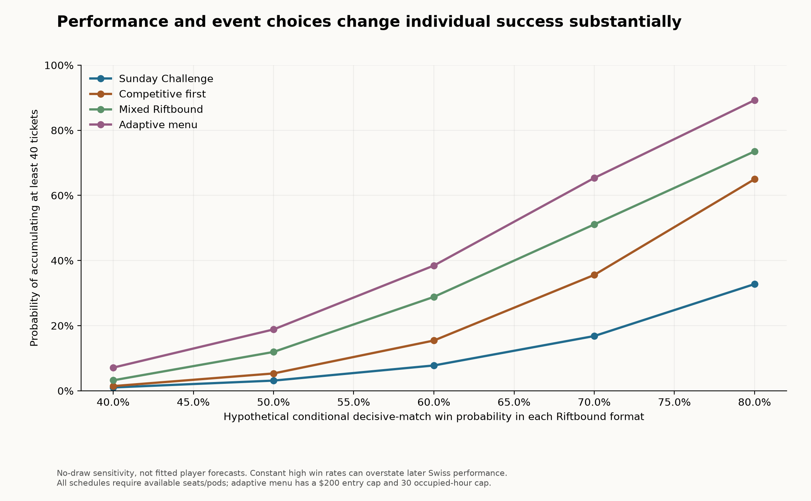
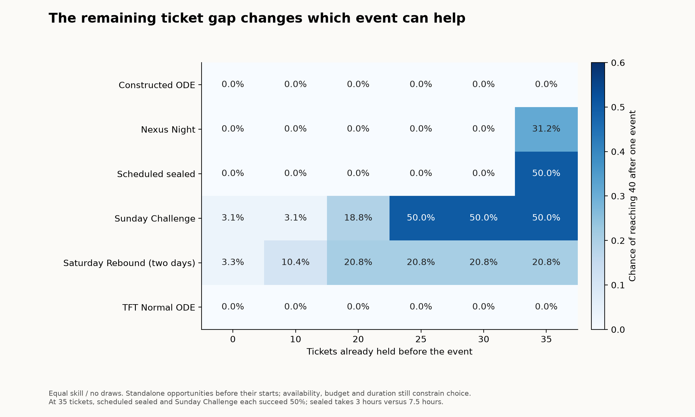

# Phase 4 — Individual Metal Legend acquisition economics

Research date: **2026-11-25, America/Chicago**. Retrieval and execution timestamps
use UTC and can fall on November 26. This phase concerns individual ticket
accumulation. No group allocation, pooling model or video script is included.

## Questions and supported conclusion

An individual can reach 40 tickets through the published Vegas side events,
but equal-skill success is far from routine in the evaluated schedules. A mixed
Riftbound itinerary improves the modeled chance substantially relative to
Saturday Rebound alone. Repeated solo Constructed ODEs are a poor route from
zero at the advertised duration: even winning every match cannot supply 40
within the modeled weekend. Small events become more useful when supplementing
an existing balance.

**The Saturday-event reduction remains supported. A whole-weekend historical
reduction is not established.** The historical archive contains side-event
payout offers, but this phase does not establish a comparable historical
weekend opportunity/attendance/queue model. The new Vegas schedules below
cannot be compared with the old Saturday probability alone to prove or refute
a weekend-level change. Having 40 tickets also does not establish that a
particular plated Legend is in stock or that redemption is permitted.

## 4A: evidence, inventory and current schedule review

The primary [official Riot schedule and prize catalog](https://teamfighttactics.leagueoflegends.com/en-us/news/esports/convergence-fest-side-events-and-the-encore-details/)
was freshly retrieved and archived in `data/raw/phase4/`. Its response body is
byte-identical to the Phase 3A capture: SHA-256
`4e8b5fb6b97eedbcb0210a4a0fd13cf773874512d4e92ae633088c2c8c53d882`.
All **33 event-table rows** also compare identically. This does not establish
that future revisions or different locale pages will agree. Live search snippets
returned older payout text; the directly retrieved US schedule governs.

The inventory distinguishes **29 ticket-awarding offers, three continuation
rows, and one Learn to Play offer without advertised prizes**. An ODE offer is
a repeatable event type, not one observed pod. Continuation rows do not create
new awards or entry opportunities. Both Riftbound and TFT share this prize
wall. There is **no sealed ODE listed**; the limited ODE is Radiance Draft.
Scheduled sealed events are separate.

`phase4_event_inventory.csv` preserves each original cell array, its schedule
row index, source ID, URL, retrieval timestamp and raw path. It also records
published start/end, format, rounds, time limit, entry fee and fee unit,
capacity and capacity unit, registration requirements, products, repeatability
and unknown earliest completion times. Dates are December 11–13 and schedule
times are **Las Vegas local time**, not the researcher's Chicago timezone.

Additional attributable captures cover:

- [Official sign-up announcement](https://teamfighttactics.leagueoflegends.com/en-us/news/community/convergence-fest-side-events-and-the-encore-details/):
  attendee/TFT competitor/Riftbound competitor pass required, Riot ID required,
  fixed events purchased ahead of time through Tixr; ODEs purchased on site.
  The announcement permits purchasing during the festival, but does not provide
  exact per-event closing times or a guarantee of late seats.
- [Official ticket vendor](https://www.tixr.com/groups/convergencefest/events/convergence-fest-200990):
  direct capture returned **403**, retained as failed content evidence. Current
  badge prices, taxes, transaction charges, stock and registration cutoffs are
  unresolved. No account, checkout or purchase was attempted.
- [Festival overview](https://convergencefest.riotgames.com/en-us/),
  [Riftbound championship information](https://playriftbound.com/en-us/news/organizedplay/north-american-regional-championship-info/)
  and [TFT championship information](https://teamfighttactics.leagueoflegends.com/en-us/news/esports/tft-vegas-open-2026-competitor-info/).
  Main championships advertise cash and other prizes, without a supported
  prize-wall ticket payout table in these captures. Their ticket amounts stay
  unknown; they are excluded from the ticket-generating model. The Riftbound
  championship requires qualification and is not an open Friday solo Challenge.

The six-source registry is `data/phase4/sources.csv`; the append-only ledger also
retains the initial restricted-network failures. Response hashes identify
uncompressed original bytes, using the existing evidence-store convention.
`data/phase4/source_review.json` contains the old/current comparison and the
catalog cells verifying **40 tickets for plated Legends**. Stock quantities,
redemption timing, badge limits and transfer permission remain unverified.

### Award and product treatment

All nine team-award rows remain in the inventory, including their continuations.
The Friday competitive event is 2v2 and pays per team. The individual division
of those tickets is not established, so no equal split or solo claim is assumed.
That exclusion also applies to team ODEs, Trios and TFT team tournaments. Team
play is not equated with manipulation; individual team entitlements simply
need better evidence before being modeled.

Free-for-All awards two tickets to the winner and one discretionary honor ticket
to another player. There is no primary individual distribution for the honor
selection. A separate exchangeable-winner sensitivity uses P(win)=1/4 and
P(honor)=0, 1/4 or 3/4. These are marginal possibilities, not estimates of how
players choose recipients. Learn to Play's explicit absence of advertised
prizing supports zero **advertised** tickets, not a claim about every giveaway.

The event inventory separately records draft boosters, sealed boosters, Champion
Deck kits, Nexus packs, conditional participation promos and TFT non-ticket
awards where published. Door-prize quantities and missing product information
remain unknown. Entry fees receive no credit for product resale or utility.
Saturday Trios also has a timing inconsistency: its 315-minute advertised duration
is shorter than 90-minute construction plus five 60-minute round limits. It is
not used in any solo schedule.

### Standalone equal-skill results

No draws; entry fees only; published event duration excludes additional ODE
queue/check-in time in this table. Rebound hours average across qualification.

| Individual event | Entry USD | Mean tickets | P(40+) | Published hours | Tickets / USD | Tickets / event hour |
|---|---:|---:|---:|---:|---:|---:|
| Constructed ODE | 10 | 1.500 | 0 | 2.25 | 0.150 | 0.667 |
| Draft ODE | 25 | 1.500 | 0 | 3.00 | 0.060 | 0.500 |
| Nexus Night | 25 | 4.000 | 0 | 3.00 | 0.160 | 1.333 |
| Scheduled sealed | 50 | 5.000 | 0 | 3.00 | 0.100 | 1.667 |
| Champion Deck Trial | 25 | 2.500 | 0 | 2.50 | 0.100 | 1.000 |
| Scheduled Draft Challenge | 25 | 2.500 | 0 | 4.50 | 0.100 | 0.556 |
| Full Box Sealed | 150 | 4.000 | 0 | 4.25 | 0.0267 | 0.941 |
| Sunday Standard Challenge | 50 | 10.625 | 3.1250% | 7.50 | 0.2125 | 1.417 |
| Saturday Rebound, including Sunday if qualified | 50 | 5.659 | 3.2715% | 11.0625 expected | 0.1132 | 0.512 |
| TFT Normal ODE | 10 | 1.000 | 0 | 1.00 | 0.100 | 1.000 |
| TFT Top Cut, full 64-player field | 35 | 4.266 | 1.5625% | 3.17–3.92 by instance | 0.1219 | instance-specific |

Exact PMFs, variance, standard deviation, zero probability, 10/20/30/40-ticket
tails, median, 10th/90th/95th quantiles and reciprocal cost/time metrics are in
`phase4_event_distributions.csv` and `phase4_event_economics.csv`. A zero mean
has undefined cost/time per ticket, stored blank. Ratios use **expected award**;
they do not measure successful-acquisition cost or redemption probability.
TFT ranks are exchangeable; Riftbound win probability is not used to forecast
TFT ability. Top Cut assumes the advertised full field and uniform final ranks.
It is not an attendance forecast. Its eliminated players retain the full
published time reservation because per-round release times are unknown.



### Separately sourced historical comparisons

All 16 historical Friday/Sunday rule rows are re-parsed from their original
official captures, with available standings-implied totals carried separately.
`phase4_historical_comparisons.csv` includes no-draw and 2% competitive-draw
benchmarks. Its exact probabilities are hypothetical marginal distributions;
its observed totals remain historical published-rule entitlements including
qualifying `DROPPED` records. No eligibility or physical-issuance field changes. Historical fee amounts retain
their original cells and explicit CAD/EUR symbols. A bare dollar symbol does
not establish USD; no foreign exchange conversion or historical USD cost
comparison is manufactured.

The closest five-round comparison is **historical Friday versus Vegas Sunday**,
not simply same-weekday events. At equal skill/no draws:

- Sydney, Vancouver, Utrecht and Hartford Friday pay 15/30/45 at three/four/five
  wins: mean 10.78125 tickets and P(40+)=3.125%.
- Barcelona, Singapore and Los Angeles Friday pay 15/30/50: mean 10.9375 and
  P(40+)=3.125%.
- Vegas Sunday pays 16/28/40: mean 10.625 and P(40+)=3.125%. This is a close
  structural comparison with changed intermediate payouts.
- Atlanta Friday and Sunday have six rounds with 24/36/48 at four/five/six
  wins: mean 9.75 and P(40+)=1.5625%. The extra round prevents an identical-format
  comparison; Vegas's 40-ticket chance is higher than this particular benchmark.
- The other seven historical Sundays have six rounds with 30/40/40 at four/
  five/six wins: mean 11.40625 and P(40+)=10.9375%. Vegas's five-round threshold
  is harder in this controlled comparison. The round count and payout table
  both change; this is not a pure payout causal estimate.

The archive also supplies **128 historical side-offer rows** in
`phase4_historical_side_inventory.csv`. For example, Atlanta's casual Constructed
ODE has the same $10, three-round 1/2/3-ticket offer and 135-minute duration as
Vegas. Atlanta also advertised a $10 competitive single-elimination ODE with
12 tickets for three wins; that type is absent from the current Vegas inventory.
Its Nexus offer is four rounds, $25 and two tickets per win. These are useful
specific offer comparisons. They do not establish actual pod frequency, a
linked attendee weekend distribution, or a common historical weekend baseline.

## Methods and performance assumptions

For conditional decisive-match probability p and independent draw probability d:

```text
P(W) = (1-d)p; P(D) = d; P(L) = (1-d)(1-p)
P(w credited wins in R independent rounds) = Binomial(R, (1-d)p)
P(award=a) = sum(P(w), published_win_table[w]=a)
```

Draws and losses both fail to add a win for win-based awards. Saturday instead
uses the existing 3/1/0 points DP and the six-round **12-point** qualification
gate. Nonqualifiers receive no fictitious Sunday rounds. Qualifiers add five
rounds and use the unchanged point payout lookup. Thus three wins and three
draws qualify; a four-win gate would be wrong.

All probabilities and convolutions use `fractions.Fraction`. Means and variances
are exact rational calculations; standard deviation is a rendered square root.
There is no Monte Carlo, random seed or convergence claim. Zero draws and the
four constant-draw cases agree with the Phase 3A/3B distributions. The established
historical 119,587 Friday and 60,556 Sunday tickets, 4,992 conditional Saturday
pool and 1,150/50,262 Swiss draws remain unchanged.

Primary reference: p=50%, no draws. Sensitivities use p=40/50/60/70/80% and
competitive draws of 0/1/2/5%. The p values are hypothetical per-format parameters,
not percentages of players in skill tiers. BO1 draws remain zero in those
comparisons and have separate 2/5% sensitivities. TFT uses placement probabilities,
not a W/D/L model. No historical draw census is fitted to BO1 or to Vegas.

A small imposed stage sensitivity uses Saturday/Sunday draw pairs of 1%/5%,
2%/2% and 5%/1%. It does not assign a strategic draw policy, record-conditioned
matchup frequency or inferred player intent. The old local matrices remain
conditional consequences, without frequency weights.

Constant high p can overstate strong-player success in later Swiss rounds,
where similarly successful opponents accumulate. There is no finite-field
pairing, bye, tiebreak, rating, opponent-learning or cross-format skill model.
Separate competitive-only rows hold Friday Nexus at p=50% while changing
competitive p; TFT remains independent of both.

## 4B: schedules and operational assumptions

The models reserve fixed start/end windows, plus 15 minutes before fixed starts
for check-in. At 11:00 starts this assumes access to check in at 10:45; actual
pass/desk access must be confirmed. ODEs start no earlier than 11:00 and add a
15-minute queue in the main scenario. They finish before the published day
windows end: Friday/Saturday 21:30, Sunday 18:30. Actual ODE last-launch/desk
closing rules are unknown; the same windows are a conditional operational
assumption, not a promise that a late pod will launch.

Every consecutive visit has at least 15 minutes between its occupied windows.
ODE-only days add a 30-minute meal after the second pod. Occupied event/queue
commitment is capped at ten hours daily; published event durations contain
unmeasured downtime for internal breaks. Those internal meal opportunities
remain assumed. No fixed event may repeat; ODE counts are finite. Registration,
pod completion and timely prize settlement are conditional on operations.

Rebound reserves Saturday through 20:00 for every entrant. It therefore conflicts
with Saturday Nexus. Qualifiers reserve Sunday 11:00–17:00 and cannot enter
Sunday Challenge at 11:00. Nonqualifiers may enter that Challenge only if advance
purchase/admission remains possible. No unverified mid-event drop entitlement,
refund, accelerated release time or ability to enter after an event begins is
assumed. The fully reserved schedule is conservative about elimination time.

- **Competitive first:** Friday Nexus; Saturday Rebound; Sunday continuation if
  qualified, otherwise Sunday Challenge. This is an open side-event path, not
  an invited main-championship participant forecast.
- **Saturday first:** same Friday/Saturday priorities, but eliminated players
  try a Sunday morning Constructed ODE and afternoon sealed.
- **ODE focused:** repeated Constructed pods, or separately TFT Normal pods.
- **Casual focused:** Friday sealed and Nexus; Saturday morning Constructed ODE,
  Trial and Nexus; Sunday Constructed ODE and sealed.
- **Mixed Riftbound:** Friday Nexus; Saturday Constructed ODE, Trial and Nexus;
  Sunday Challenge.
- **Mixed with TFT:** Friday Nexus; Saturday Constructed ODE and Top Cut #1;
  Sunday Top Cut #3 and an afternoon Constructed ODE. All TFT ranks remain
  exchangeable; this is not a prediction of a Riftbound player's TFT performance.
- **Ticket-aware adaptive:** select or skip from eight chronological decision
  groups, conditional on current tickets, money, occupied-time resource and
  prior event end. Its 15-action menu and reachable decisions are exported.

These are theoretical schedules with operational buffers, conditional on
availability. They are not observed attendee itineraries or guaranteed realistic
throughput estimates. Seat denial and uncertain queues can only reduce the
available opportunity set; no numerical admission probability is invented.



## 4C: acquisition probability, money and time

Equal skill, competitive and BO1 draws zero; queue 15 minutes; published
durations. All averages include unsuccessful attendees. Stop **after an event's
award settles** at 40+, rather than midway through rounds. This delays some
per-win ticket acquisition conservatively. “Occupied hours” sums event and
queue/check-in commitments. It excludes gaps between separate events and
sleep; “calendar span” in CSV runs from Friday 11:00 to the final event settlement,
including overnight gaps. It is not active playing time.

The following block is generated from, and audited against, the strategy CSV.

<!-- phase4-summary-start -->
| Strategy | P(40+) | Expected tickets | Expected entry USD | Maximum paid USD | Occupied hours | Active hours proxy |
|---|---:|---:|---:|---:|---:|---:|
| Sunday Challenge only | 3.1250% | 10.625 | 50.00 | 50 | 7.75 | 3.75 |
| Competitive first | 5.3223% | 16.632 | 107.81 | 125 | 19.73 | 9.75 |
| Saturday first | 3.2715% | 13.925 | 114.38 | 135 | 18.42 | 8.77 |
| Mixed Riftbound | 11.9255% | 22.625 | 135.00 | 135 | 19.50 | 9.00 |
| Casual focused | 0.0007% | 23.500 | 195.00 | 195 | 20.75 | 8.62 |
| Constructed ODE focused | 0.0000% | 12.000 | 80.00 | 80 | 20.00 | 9.00 |
| TFT Normal ODE focused | 0.0022% | 19.000 | 190.00 | 190 | 23.75 | 14.25 |
| Mixed with TFT | 6.3206% | 15.331 | 113.49 | 115 | 15.17 | 8.61 |
| Adaptive Riftbound menu | 18.8359% | 25.922 | 175.64 | 185 | 21.16 | 9.36 |
<!-- phase4-summary-end -->

The adaptive menu has a hard $200 cap and 30 occupied-hour cap. Its primary
policy actually spends at most $185; this is not a claim that $185 reserves
all 15 possible actions. Maximum paid means the largest expenditure along a
reachable path. Prebuying mutually exclusive alternatives can cost more:
fixed strategies export full reservation exposure separately, with no assumed
refund for elimination or stopping. The pay-as-entered figures require the
chosen event still to admit the player. Precommitting every entry and paying
only as needed are distinct purchasing scenarios.

Conditional successful-attendee entry costs also differ: approximately $94.27
for competitive first, $135 for mixed Riftbound, and $175.69 for the adaptive
menu in the primary case. They must not replace the unconditional means in
the table. Failures still incur entry costs. Conditional first-passage time is
reported only for successes, at event-settlement resolution. Unsuccessful
attendees have no finite first-hit time within this weekend; their spending
and occupied time up to horizon remain in unconditional metrics.

The primary mixed schedule has E[tickets]=22.625 but P(40+)=11.93%.
Dividing that expectation by 40 gives 56.56%, **not** the success probability.
Quantiles, zero probability, failure probability and expected surplus above
40 among successes are retained in the CSVs. No tickets from different people
are combined.



### Performance and draws

At p=70% in each Riftbound format, no draws, the mixed schedule's success chance
is about **51.09%** and the adaptive menu's is **65.35%**. At p=80% they are
73.52% and 89.24%. Those are optimistic constant-performance sensitivities,
not forecasts for named players or real-world “strong player” tiers.
Competitive first reaches about 35.57% at p=70% and 64.98% at p=80% without
draws, even when Nexus performance alone remains 50%.

At equal skill with **2% competitive draws** and BO1 still at zero, mixed
Riftbound is **11.10%**, competitive first **4.95%**, and the adaptive menu
**17.64%**. Do not interpret these as calibrated Vegas frequencies. Separate
stage/BO1 and active-time sensitivities are exported rather than silently
borrowing the historical 2.2880% across every format.



### Queues, duration and availability

At 135 minutes per Constructed pod plus 15 minutes queuing, the model fits
**eight pods**: three Friday, three Saturday, two Sunday. That is $80,
20 occupied hours, mean 12 tickets and a maximum of 24. With zero queue it fits
11 pods and still caps at 33 tickets. Those bounds do not depend on win skill.
Winning fourteen pods would be needed for 42 tickets, beyond these schedules.

`phase4_queue_duration_sensitivity.csv` varies queues over 0/15/45 minutes,
uses the official Constructed/Draft/TFT durations, adds an explicitly unverified
90-minute faster completion case for the Riftbound pods, and removes Saturday
as an availability stress case. Shorter ODE completion is not established by
the advertised round time limit. The full repeated count includes breaks;
it is never continuous instantaneous matchmaking. Even a zero-queue theoretical
schedule still assumes enough opponents and late launches.

TFT Normal's shorter duration permits 19 pods in the primary schedule, with
mean about 19 tickets and only **0.00221%** success under exchangeable ranks.
This separate game does not rescue routine 40-ticket acquisition for an
exchangeable attendee. A real TFT specialist needs a different, evidenced
placement model. Casual focused has mean 23.5 but success below 0.001%; its
42-ticket maximum is barely above the target, so almost everything must go well.

Active playing hours use 75% of published round limits, excluding construction.
50% and 100% proxies are tabulated separately. This is not observed match
length, and the 100% proxy is a time-limit reference rather than a measured
upper bound after extensions. TFT weekend active time is a 75%-of-reserved-slot
proxy and may include waiting; its event economics leave measured active time
unknown. No strong active-hour comparison should be made from that proxy.

### Starting tickets, hard budgets and finite-menu optimization

Starting holdings 0/10/20/25/30/35 are all tabulated. From 35, one Constructed
ODE cannot close the five-ticket gap. Scheduled sealed reaches 40 with 50%
probability at equal skill, versus 31.25% for Nexus. Sunday Challenge also gives
50%, but reserves 7.5 event hours versus sealed's three for the same $50 entry.
From zero, neither sealed nor Nexus alone can reach 40, while Challenge can.
At 20 existing tickets, Challenge requires four wins and succeeds 18.75%.

The Sunday-only adaptive sensitivity uses the remaining two decision groups,
entry caps of $25/$50/$75 and a 7.75 occupied-hour ceiling including check-in.
It reports sequence probabilities, separately from the one-event comparisons;
there is no universal “best event” without a resource and availability constraint.



The Bellman recursion maximizes P(40+) under **hard** money and occupied-time
limits. Tickets are capped at 40 only in the value state; replay retains actual
overshoot. Equal-success ties prefer smaller expected expenditure, then occupied
time. These tie-breakers do not exchange success for an arbitrary utility score.
Only observed past awards enter decisions. No future results or opponents are
known. The action menu excludes Rebound, TFT and team events, so its optimum
is explicitly limited to that menu, not the festival's globally best strategy.

For equal skill/no draws, a $100 / 20-hour cap gives about 5.38% success;
$150 / 20 hours gives 14.48%; $200 / 20 hours gives 17.16%; and $200 / 30 hours
gives 18.84%. At ten occupied hours, all evaluated budgets $50–$250 select the
3.125% Sunday benchmark. Spending more does not automatically improve a
constrained policy. Unused budget is allowed.

`phase4_pareto.csv` reports nondominated **evaluated** strategies for each
performance/draw scenario using success, expected entry expenditure and, separately, occupied
hours or calendar elapsed hours. It is not a global frontier or a combination of incompatible player
assumptions. Unknown seat probabilities and missing drop rules prevent a
reliable festival-wide operational optimum.

## Answers for the research video

1. **Can an average individual realistically reach 40?** The equal-skill model
   supplies plausible conditional paths, but no evaluated primary schedule makes
   success routine. Mixed is about 12%; the declared adaptive menu about 19%,
   requiring substantial entry spending and weekend commitment. “Average” here
   means the explicit 50% benchmark, not an estimated population average.
2. **Does strength change the answer?** Yes in the parameter model. A constant
   70% competitive probability raises competitive-first success to about 36%,
   and being similarly strong across all modeled Riftbound formats raises the
   adaptive case to about 65%. Real later-round opponent strength could reduce
   these figures materially.
3. **Competitive events or repeated ODEs?** Sunday Challenge has the best primary
   expected ticket yield per entry dollar among the modeled individual offers.
   Repeated Constructed ODEs cannot reach 40 from zero under published durations
   and these windows. ODEs can still supplement a balance or provide entertainment;
   full product value and player preferences are outside ticket-only efficiency.
4. **How much time and money?** Sunday alone is $50 and 7.75 occupied hours;
   representative mixed is $135 and 19.5 hours; adaptive averages about $176
   and 21.2 hours with $185 maximum spent along its primary policy. Badge and
   travel costs are additional and unresolved. Success-conditional cost is
   reported separately, and none of these amounts guarantees a metal.
5. **Do alternatives offset Saturday changes?** They meaningfully raise Vegas
   acquisition chances for players who can use them: mixed exceeds Saturday
   alone, while qualifying for Rebound blocks Sunday Challenge. Several useful
   historical alternatives existed too. This demonstrates supplementation,
   not a quantified net offset against historical weekends.
6. **Is the title proven at weekend level?** No. The matched-attendance Saturday
   benchmark supports a harder Saturday path (6.25% historical at N=512 versus
   3.2715% Vegas without draws), but no like-for-like entire-weekend decline has
   been established. Keep the working title provisional at that broader level.

Supported video material includes the explicit payout changes, the Saturday
result, structural ODE throughput bounds, the balance-dependent role of small
events, the conditional mixed-path improvement, and honest time/cost tradeoffs.
Speculation includes behavioral draw frequency, real skill tiers, actual pod
throughput, admission chances, festival-wide optimality, team ticket control,
and actual metal redemption or prevalence of coordination.

## Outputs, reproducibility and validation

All Phase 4 files use separate `phase4_*` table/figure names. The core module is
`models/individual.py`; the orchestrator is `phase4.py`; the isolated collector
is `collectors/phase4_sources.py`. The Phase 4 payout mappings are cross-checked
against captured cells and boundary tests; no historical payout function changes.

Tables cover inventory, all primary event PMFs, economic and performance
sensitivities, BO1/stage draws, honor-selection bounds, active-time proxies,
queue/duration/availability scenarios, strategy definitions/results/primary
final PMFs, the adaptive menu/reachable policy, starting balances, hard-resource
success, evaluated Pareto rows, historical comparisons/side offers, other
advertised main events, and assumptions/gaps. Seven SVG/PNG pairs reproduce
from these tables; the figure manifest hashes inputs, renderer and outputs.

```sh
# Network only; preserves additional snapshots without changing prior phases:
PYTHONPATH=src python3.12 -m riftbound_tickets.phase4 collect --refresh
# Offline:
PYTHONPATH=src python3.12 -m riftbound_tickets.phase4 build
PYTHONPATH=src .venv-figures/bin/python -m riftbound_tickets.phase4 figures
PYTHONPATH=src python3.12 -m riftbound_tickets.phase4 audit
python3.12 scripts/validate_phase4.py
```

The validation runner executes the full standard-library unittest suite, all
five required legacy commands, Phase 2/3A/3B audits, and Phase 4 build/figure/audit.
It records actual command output, timestamps, exit codes, Python version and
log hashes under `outputs/phase4/validation/` and
`outputs/tables/phase4_execution_validation.json`. Its result is authoritative
for whether commands actually passed; an archived Phase 3 report is not a fresh
execution claim. The numerical report table is rebuilt/audited from CSV.

**Actually executed on 2026-11-25 America/Chicago (2026-11-26 UTC): 139 tests
passed, and all 11 runner commands exited zero.** All 794 protected files remained
byte-identical. The seven figure pairs rendered successfully, were visually
reviewed, and passed input/output hash checks. The first failed-run log is
retained; its missing exact-zero CSV field was corrected before the successful
runs. Earlier Phase 4 execution summaries are retained as `attempt01`/`attempt02`;
the current summary identifies the final code and log hashes.

`data/phase4/preserved_artifacts.json` fingerprints **794 prior tracked files**
from `ab77b63`, excluding explicitly updated README, Makefile, handoff, roadmap,
changelog and the general current-code validation report. Raw evidence, all
previous analyses, modules, tests, tables, figures and execution records are
protected. The general validation report may add new code hashes. No prior
research output is replaced by individual models.

## Evidence that would change the findings and Phase 5 handoff

High-value missing evidence is the final schedule, desk last-launch/cutoff and
wait times, actual pod fill/completion rates, event attendance and sold-out
states, conditional Sunday registration, check-in access before 11:00, drop and
prize-claim timing, actual round/meal breaks, team award allocation rules,
full required entry costs, and current badge/redemption/transfer policy.
A historical attendee/opportunity model would need comparable assumptions
and validation before a weekend-change claim. Inventory/claim records would
be needed to model redemption separately from accumulation.

Phase 5 may reuse the exact individual award distributions, stopping semantics,
separate ticket/product units and schedule constraints. It must first verify
current transfer/control rules before assuming pooled access or recipients.
Groups of 2/4/8, concentrating spare tickets and participant-hour comparisons
are **not implemented here**. Do not equate sharing with match manipulation.
No message was sent to players or organizers; no identifying research was
performed. Changes remain available for review, without push or deployment.
