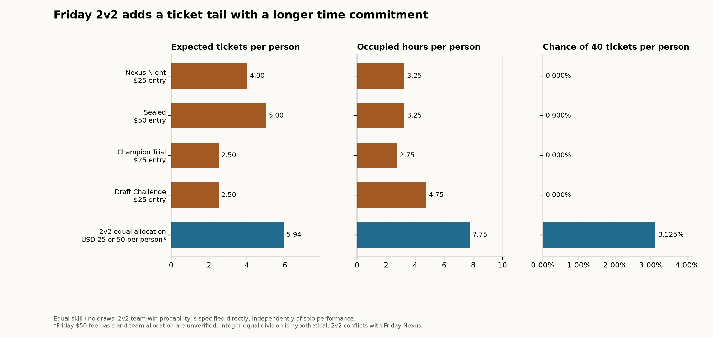
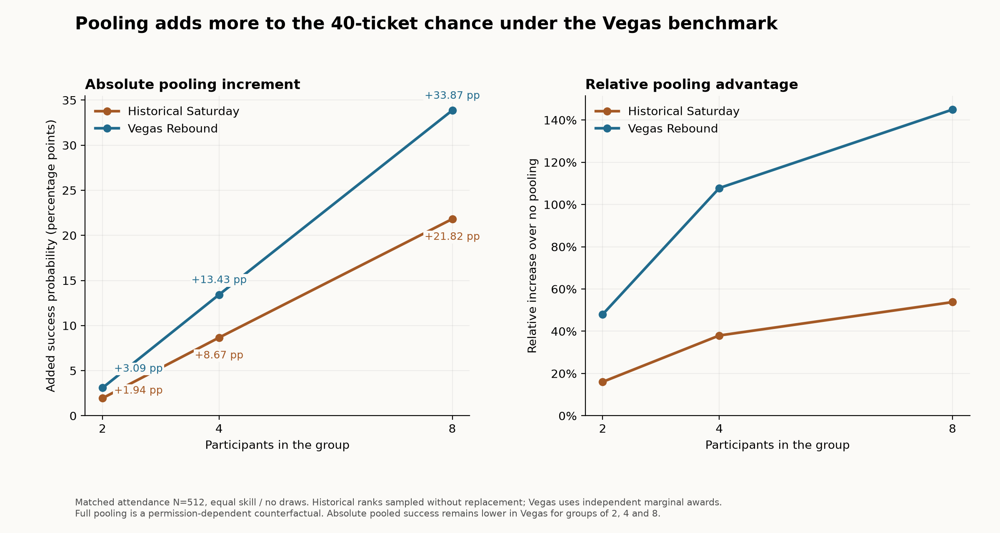
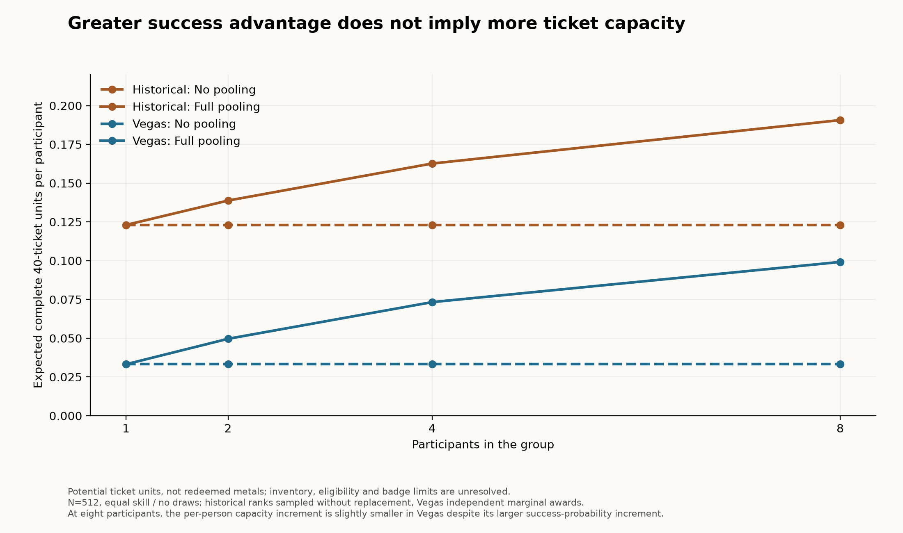
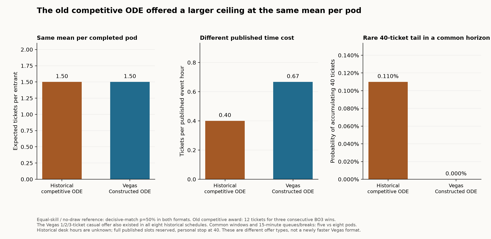

# Phase 5 - Team events and ticket aggregation

Research date: **2026-11-26, America/Indianapolis**. Scope: core research for the
provisional 15-18-minute research video, **Why It Just Got Harder to Get a Metal
Legend**. This is not the beginner's guide, buying recommendations, secondary
market valuation, a script or production plan. All accumulation/capacity results
remain separate from physical ticket issuance and actual prize redemption.

## Principal findings

The redesigned Saturday increases the **absolute and relative pooling increment
in the chance of one group threshold** for groups of two, four and eight in the
specified benchmark. Nevertheless, the **absolute pooled success chance remains
lower in Vegas**. Those statements describe different quantities and are both
true. The capacity result is less uniform: at eight people, the gain in complete
40-ticket units per participant is slightly smaller in Vegas than under the old
official-placement allocation. The reported Top 8 split scenario changes that
last comparison slightly and remains a separate, uncorroborated scenario.

Friday's 2v2 Challenge is a meaningful omitted path from Phase 4. It pays a mean
**11.875 tickets per team** at 50% team win probability without draws. Hypothetical
equal allocation gives **5.9375 per person**, with a **3.125% personal chance of
40+**. The team collectively reaches 40 with probability **18.75%**. Those are
not interchangeable probabilities or verified individual entitlements. The
published fee basis and award allocation remain unresolved.

Historical competitive Constructed ODEs were offered in all eight archived
cities. Their 12-ticket winner-only award and Vegas's three-round win-based
1/2/3-ticket award both average 1.5 tickets per entrant per completed pod at equal
skill. The shorter casual format has the higher mean rate, while the competitive
offer has a much higher ceiling and a rare accumulation tail. All eight old
schedules also offered that casual format, so the rate difference is not a new
Vegas improvement. This is not evidence of a whole-weekend historical decline by itself.

## Current policy and source review

Fresh read-only captures are isolated in `data/raw/phase5/retrievals.jsonl`,
with original bytes, URL, UTC timestamp, HTTP status, headers and SHA-256 using
the established decompressed-body convention. `data/phase5/sources.csv` indexes
eight current official sources. The current US schedule's 33 rows match Phase 4.
No previous capture, historical payout, export or execution log was changed.

Reviewed sources include the [official schedule/catalog](https://teamfighttactics.leagueoflegends.com/en-us/news/esports/convergence-fest-side-events-and-the-encore-details/),
[sign-up announcement](https://teamfighttactics.leagueoflegends.com/en-us/news/community/convergence-fest-side-events-and-the-encore-details/),
festival overview, main-championship information, ticket vendor, current
[Rules Hub](https://playriftbound.com/en-us/rules-hub/), its linked tournament
rules PDF, and the official eleventh-round announcement. The ticket vendor again
returned **403**. No organizer or attendee was contacted and no account,
registration, payment, ticket transfer or other external mutation was attempted.

The [current tournament rules PDF](https://cmsassets.rgpub.io/sanity/files/dsfx7636/news_live/861752822d217edf37d9febaeaf77a7d924c1bb6.pdf)
and its rendered first page both say **October 9, 2026**. Page 48, section
704.5.b, permits certain general prize-sharing agreements with restrictions on
outcome-, action- and drop-contingent arrangements. Section 704.5.a prohibits
outcome-contingent rewards. Page 1, section 104.3, gives specific event addenda
precedence. These are general competition provisions, not an explicit ruling
on post-award prize-ticket ownership, pooling across attendees or tournaments,
ticket sales, or prize-wall redemption.

The readable byte-identical PDF copy and extracted text are under `data/phase5/`;
reviewed page renders are under `outputs/phase5/policy/`. Extraction library and
file hashes are in `policy_extraction.json`. The offline model uses the reviewed
extraction; PDF extraction/rendering is a separate collection/review dependency.

| Question | Evidence classification | Consequence |
|---|---|---|
| General prize sharing with conditions | Explicit conditional permission, tournament rules 704.5.b | Does not establish unrestricted ticket pooling |
| Rewards contingent on game outcomes/actions | Explicit prohibition, 704.5.a | No such outcomes or strategies are modeled |
| Prize-ticket transfer/ownership across attendees | Ambiguous; no specific permission established | Pooling remains a counterfactual |
| Combining different side-event ticket sources for prizes | Catalog explicitly allows cross-event prize eligibility | Does not establish cross-attendee pooling |
| Metal inventory, per-person/badge caps and redemption identification | Unavailable in reviewed event sources | Units are theoretical; one-per-person is a labeled sensitivity |
| Friday team tickets | Explicit per-team totals | Never multiply the team award by two |
| Friday fee unit and individual allocation | Ambiguous | Model both fee interpretations and explicit hypothetical allocations |
| Riftbound team ODE enrollment | Individual enrollment into four teams/eight players | $10 per enrolled player; team prize remains a separate unit |

`phase5_policy_evidence.csv` records each interpretation, its limits, source ID,
retrieval, raw path and section/page. No absence of a restriction is treated as
permission. Side-event entry requires the specified pass/Riot ID; that alone
does not verify every prize-redemption requirement. An unverified one-metal-per-
badge practice must not be presented as current official policy.

The verified primary [organizer announcement](https://x.com/RiotSherman/status/2122889583201591569)
also says TFT ODEs open at **noon Saturday**, unlike the generic all-weekend
schedule wording. Phase 4's all-weekend TFT ODE rows remain preserved conditional
models, but should not become itinerary advice. This phase's modeled weekend
paths use Riftbound events, so this additional constraint does not change them.

## Team-event economics and Friday opportunities

`phase5_team_inventory.csv` retains all nine team schedule rows, including two
TFT continuation rows, full original cells, time windows, enrollment, fees,
rounds, capacity units and prizing. The four Riftbound formats receive exact
W/D/L sensitivities. TFT team offers remain inventoried; their different lobby
and bracket processes are not assigned a Riftbound team W/D/L model. No TFT
team weekend or universal all-game optimum is claimed.

| Riftbound event | Fee evidence | Rounds / published duration | Team tickets |
|---|---|---|---|
| Friday Radiance 2v2 Team Challenge | $50, unit unspecified; scenarios $50/team or $50/person | Five BO1 Swiss, 50-minute limits, no cut; 7.5 hours; 11:00-18:30 | Points 7-8: 5; 9: 10; 10-11: 25; 12: 40; 13-14: 60; 15: 80 |
| 2v2 ODE | $10 per individually enrolled player, $20 for two entries | Two BO1 pod rounds, 60-minute limits; 2.5 hours; launches at eight players | One win: 3; two wins: 6; zero wins: 0 |
| Saturday Trios Sealed | $50 per individually enrolled player, $150 for three entries | Five team rounds; 5.25 published hours, with 90-minute construction and 60-minute limits | Zero wins: 3; otherwise nine per team win |
| Sunday 2v2 Constructed | $25 per individually enrolled player, $50 for two entries | Four BO1 rounds, 60-minute limits; 5.5 hours | 4/8/12/16/20 at zero through four wins |

Trios awards 15 construction boosters per team. Other non-ticket awards are
retained in the original prize/description cells; missing quantities remain
unknown, not zero or a monetary credit. Trios's published duration is shorter
than the construction-plus-maximum-round-time budget; actual occupancy needs
clarification. It is not inserted into a weekend schedule.

Team performance p is specified directly at **40/50/60/70/80% conditional on a
decisive team round**, with draws d=0/1/2/5%. P(W)=(1-d)p, P(D)=d and
P(L)=(1-d)(1-p). No multiplication or average of individual skill estimates is
used. Friday scores 3/1/0 over five rounds and looks up the captured point
bands. Other Riftbound team formats price recorded wins. Draw probabilities are
sensitivities, not measured or strategic behavior. The full team PMFs, variance,
quantiles and tails are in `phase5_team_distributions.csv` and
`phase5_team_economics.csv`.

### Individual allocation and entry-cost scenarios

No individual ownership rule was found. `phase5_team_allocation.csv` therefore
keeps individual entitlements hypothetical. It reports equal integer division
and prioritizing role A, for every modeled Riftbound team format. An odd award
is split using whole tickets: for example 5 becomes 2+3, not 2.5+2.5; fixed roles
preserve that asymmetry. Trios uses the analogous three-way integer rule.

At equal team skill/no draws, Friday awards are 0/10/40/80, so equal division is
exact: 0/5/20/40. Thus personal 40+ requires an undefeated team. Giving the entire
award to A raises A's standalone chance to 18.75% while B receives zero tickets.
This is an allocation example, not an authorized arrangement or extra tickets.

Friday per-person expected tickets per entry dollar are **0.2375** if the fee
is $50/team and shared equally, or **0.11875** if each participant pays $50.
Nexus is 0.16. Team play is therefore not uniformly better on entry-cost yield.
Adding check-in, Friday 2v2 reserves **7.75 occupied hours**, versus Nexus's
3.25; its mean tickets per occupied hour is about **0.766**, versus **1.231**
for Nexus. It has a personal 40-ticket tail that the small solo Friday events
lack, but takes more time than Nexus, sealed or Champion Trial alone.

A feasible **sealed plus Nexus** Friday has mean nine tickets, costs $75 and
uses 6.5 occupied hours, with no solo 40-ticket possibility. It finishes later
in the day than the team event and requires seats in both events. The 2v2 event
ends at Nexus's 18:30 start, so the check-in/break constraints prohibit combining
them. They are alternatives, not additive ticket sources.



### Small weekend extension

A concrete new path replaces mixed Riftbound's Friday Nexus with Friday 2v2,
then retains its Saturday Constructed ODE, Trial and Nexus, plus Sunday Challenge.
The team is a single shared Friday random outcome. Later individual paths are
independent conditional on it; each member stops after an event settles at 40.
This correctly makes the two teammates dependent. Different pairs remain an
explicit independence approximation, not a joint Swiss simulation.

With equal team/solo p=50% and no draws, hypothetical equal allocation changes
a member's 40+ chance from **11.93% to 17.47%**. Expected per-person entry spend
is **$131.56 or $156.56** under the two fee interpretations, versus $135 for the
original mixed path. Occupied time rises from 19.5 to **23.49 expected hours**.
Its unstopped reservation is 24 hours; the undefeated Friday case stops early.
These are conditional opportunities, not a new universal recommended itinerary.

For two such teammates, at-least-one personal success is **27.27%**. Treating
their Friday awards as independent would be wrong. Their aggregate 40+ chance
is **61.29%**, versus **60.77%** for two original mixed individuals. The small
aggregate improvement is much less dramatic than the personal improvement.
Allocation also affects later production: giving Friday tickets to A can stop
A earlier, changing costs and potential units, even with the same Friday pool.
No individually stopped distribution is presented as continued production.

## Saturday aggregation: primary historical comparison

The primary old reference is the conditional funded N=512 historical official
rank allocation. Groups are sampled **without replacement** from those 512
slots. Vegas uses the established N=512 equal-skill marginal Rebound PMF, with
six Saturday rounds, a 12-point gate and five Sunday rounds. It uses **independent
marginals across group members**. Neither their joint Swiss correlations nor
byes/pairings/attendance are inferred from this marginal model.

The table below is generated and audited from `phase5_saturday_comparison.csv`.
All probabilities concern at least one 40-ticket threshold somewhere in the
group, not each member receiving a metal. Full pooling assumes unrestricted
control and redemption eligibility that have not been verified.

<!-- phase5-summary-start -->
| People | Historical: no pooling | Historical: full pool | Vegas: no pooling | Vegas: full pool | Pooling increment, historical → Vegas |
|---:|---:|---:|---:|---:|---:|
| 2 | 12.12% | 14.07% | 6.44% | 9.53% | 1.94 → 3.09 pp |
| 4 | 22.81% | 31.48% | 12.46% | 25.89% | 8.67 → 13.43 pp |
| 8 | 40.55% | 62.36% | 23.36% | 57.23% | 21.82 → 33.87 pp |
<!-- phase5-summary-end -->

Define the absolute increment as P(group total >=40) minus P(any member has
40 alone). Relative lift divides that increment by the no-pooling probability.
At two/four/eight people the old relative lifts are approximately
**16.04% / 37.99% / 53.80%**, versus Vegas **48.01% / 107.80% / 144.95%**.
The no-pooling denominator is lower in Vegas, but the absolute increments also
increase; this result is not merely a denominator artifact.



### Potential units and fragmentation

For balances t_i, define:

```text
No-pooling potential units = sum(floor(t_i / 40))
Full-pooling potential units = floor(sum(t_i) / 40)
No-pooling fragmented remainder = sum(t_i mod 40)
Full-pool residual = sum(t_i) mod 40
```

Expected qualifying people and P(everyone independently has 40) are separately
reported. A player holding 80 contributes two **ticket units**, but is only one
qualifying person. No current one-per-person/badge entitlement is inferred;
the table separately caps possible units at one per person as a sensitivity.
All residual/retained tickets still belong to someone and can have other uses.
No resale prices or assumption that leftovers are worthless enters the model.

At eight people, old official allocation yields **0.12305 units/person without
pooling and 0.19068 with pooling**. Vegas gives **0.03320 and 0.09918**. The
capacity increment per person is **0.06763 old versus 0.06597 Vegas**: slightly
smaller after the redesign, despite the larger success-probability advantage.
Pooling never creates gross tickets; it reduces fragmentation into complete
40-ticket units and changes who can control those units.



The historical Top 8 equal split remains separate and conserves 1,728 tickets
within the 4,992 pool. It leaves the 40+ success probabilities above unchanged,
but changes complete-unit/remainder accounting. At eight people, its capacity
increment is **0.06528/person**, slightly below Vegas's 0.06597. Thus the sign
of that small capacity comparison depends on the specified old allocation.
There is no new evidence that any historical event used the split.

### Draws and independence checks

Vegas draws of 0/1/2/5% reuse the Phase 3B point PMFs. At eight people and 2%
draws, no-pooling group success is **20.43%**, pooled success **53.67%**, a
**33.24-point increment** and **162.66% relative lift**. At 5% draws, relative
lift rises to about 189.82% even though pooled success falls to 47.98%.
Increasing the relative advantage is not equivalent to improving acquisition.

The independent historical convolution is also retained as a comparison with
the finite-population result. At eight people, independent historical pooling
is 62.18%, versus exact without-replacement 62.36%; no-pooling is 40.33% versus
40.55%. Independence can sample the same scarce rank slot more than once.
The hypergeometric result is the appropriate fixed-placement primary reference.
Vegas marginal data do not provide an equivalent exact joint field distribution;
no invented correlation scenario or full Swiss simulator fills that gap.

## Weekend group implications and partial sharing

Only four complete Phase 4 individual distributions are reused: competitive
first, mixed Riftbound, adaptive Riftbound and Constructed ODE focused. The
baseline table retains each person's original event-boundary stopping at 40,
all costs from unsuccessful paths, and their respective resource assumptions.
No group-level early stop or new shared-target adaptive optimization is used.

For **four mixed players**, no-pooling at-least-one success is **39.83%**;
full-pool 40+ is **99.47%**. Expected potential units rise from **0.477 to 1.777**
for the group. Expected entry expenditure is **$540**, with **78 occupied
participant-hours**. However, capacity for all four to receive one 40-ticket unit
is only **0.405%**, before eligibility and inventory constraints. One likely
recipient is not four likely recipients.

Four adaptive individuals have **99.9996%** pooled single-threshold chance but
only about **1.67%** capacity for one unit each, and require more expenditure
and participant-hours than mixed. These very high group probabilities arise
from aggregating stopped individual outcomes; they are not admission forecasts
or guarantees of inventory. Exact fractions remain in CSV instead of rounding
near-one probabilities into certainty.

Four Constructed ODE-focused individuals each remain unable to reach 40 in the
primary schedule. Their independent aggregate nevertheless reaches 40 with
**95.89%** probability. That costs **$320** and **80 occupied participant-hours**;
expected capacity is about **0.959 units total**, not four metals. Shared pods,
opponent dependence, queues and access could change the joint distribution.
This is a mathematical aggregation effect, not evidence of any group's conduct.

`phase5_weekend_groups.csv` reports groups 1/2/4/8, total/per-person entry spend,
occupied participant-hours and expected calendar wall span to the last member's
stopping time. Wall span starts at the common **Friday 11:00 reference** and
includes idle/night gaps; it is not active playing time or a sum of participant
hours. Independent clock CDFs give E[max(clock_i)] for solo blocks. New team
paths retain the shared Friday clock within each pair. For four mixed players,
the common wall span is 55.5 hours versus 78 occupied participant-hours.

### Two explicit partial-contribution protocols

Both are hypothetical, preserve personal holdings where specified, and use the
original stopped individual distributions:

1. **Own-first surplus:** people already at 40 reserve their first 40, and only
   their excess is donated. People below 40 keep their balances. A predesignated
   recipient uses their own retained balance plus donations to top up first;
   remaining donations form whole units. Other below-40 balances remain with
   their owners. This is not full pooling of all small balances.
2. **Keep ten remainder tickets:** everyone reserves all personally complete
   40-ticket units, keeps up to ten of their remainder tickets for other prizes,
   and contributes only the rest. Pooled contributions fund additional units.
   Existing owners keep their reserved units; contribution-funded units can go
   to a predesignated nonowner first.

For four mixed players, own-first surplus gives the predesignated member a
**15.08%** success chance, versus **48.71%** under the keep-ten protocol.
At-least-one qualifying recipient probabilities are **39.83% / 69.27%**, and
expected capacities **0.509 / 0.883 units**, well below full pooling's 1.777.
The recipient probabilities differ from the chance someone in the group succeeds.
`phase5_partial_pooling.csv` also reports residual/retained tickets and protocol-
specific capacity for every member; these are defined allocation protocols,
not claims that transfers are permitted or that retained tickets lack value.

## Historical competitive ODE comparison

All eight official archives show the three-consecutive-win, single-elimination,
BO3 offer, with 12 tickets to the undefeated winner and 225 published minutes.
Fees are preserved as published: Atlanta/Hartford/Los Angeles $10; Sydney and
Singapore $15; Vancouver CA$15; Utrecht/Barcelona EUR10. Bare dollar symbols
remain currency-ambiguous in the machine-readable evidence; no exchange-rate
conversion turns them into common USD prices.

For a hypothetical decisive-match p, the old pod PMF is 12 with probability p^3,
zero otherwise. Vegas's pod award is Binomial(3,p) tickets. At p=50% both means
are **1.5**. The old competitive maximum is **12** versus **3**, but its published mean rate
is **0.4 tickets/hour**, versus **0.6667** for the casual format before queues.
All eight archived schedules already offered that 135-minute, three-round
1/2/3-ticket casual Constructed event too. These are different offer types,
not a replacement that newly improves Vegas's mean throughput. Constant p
across BO3 and BO1 is a controlled assumption, not measured equivalent ability.

The controlled reference uses the same three daily windows, queue 15 minutes,
15-minute breaks and a 30-minute meal after a second pod. Using each format's
published duration fits **five old versus eight Vegas pods**. Historical desk
hours and actual pod availability are unknown, so this is a conditional example,
not an observed historical itinerary. Every attempted old pod reserves its full
slot despite possible earlier elimination; loss-release timing is not invented.

With personal stopping at 40, old expected tickets are about **7.4996**, entry
spend **49.9976 nominal dollar units**, occupied hours **19.9990**, and success
**0.10986%**. Vegas produces mean 12 at $80/20 occupied hours and cannot reach
40 (maximum 24). This demonstrates a lost rare tail alongside a higher-rate casual option that
already existed historically. It is not an overall historical-weekend
acquisition estimate. Equalizing both formats to 225-minute slots gives five pods each and essentially equal
mean production; the ceiling distinction remains. Non-ticket prizing is not
valued and nominal fee sensitivities are not historical currency conversions.



## Answers for the research video

1. **Does Saturday increase relative or absolute pooling advantage?** Both
   increase for the one-group-threshold probability at sizes 2/4/8 in this
   benchmark, while the absolute pooled chance falls. For potential-unit
   efficiency, there is no uniform increase across group size and old allocation.
2. **How large?** Pooling increments rise from about **1.94/8.67/21.82 points**
   historically to **3.09/13.43/33.87 points** in Vegas for 2/4/8 people.
3. **Does efficiency per participant improve with pooling?** Yes, complete-unit
   capacity rises at fixed gross tickets by consolidating remainders. It does
   not create tickets, establish redemption permission or make every attendee
   a likely recipient. Absolute capacity remains lower in the Vegas benchmark.
4. **Is Friday 2v2 attractive?** It offers a personal high tail under hypothetical
   equal allocation and a meaningful team-total threshold chance. Its ticket/
   dollar ranking depends on the unresolved fee unit; its mean time efficiency
   is lower than Nexus. It is an option to consider, not a universal upgrade.
5. **Does adding it change itineraries?** It expands the conditional menu and
   raises the mixed member example to 17.47%, but adds time and excludes Friday
   Nexus. The two-member aggregate improvement is small. Cost, admission,
   actual allocation and team/solo performance must be resolved before a strong
   attendee recommendation; no Friday field weakness is assumed.
6. **What changed historically in competitive ODEs?** The eight documented
   winner-only offers are absent from the current Vegas inventory. Equal-skill
   mean tickets per pod are unchanged; the ceiling, distribution, format and
   published time differ. The casual format was already available historically;
   no new Vegas mean-throughput improvement or whole-weekend decline is established.
7. **What is video-ready?** The exact threshold/capacity distinctions, conditional
   Saturday increments, preserved counterexamples, documented Friday/ODE tables,
   scheduling conflict and participant-hour tradeoffs, with stated assumptions.
8. **What remains conditional or contradictory?** Transfer permission, team
   entitlement/fee allocation, admission/throughput, real fields and redemption;
   lower absolute pooled success, the nonuniform capacity increment, the split
   sensitivity, and the higher rate of a historically available casual format
   qualify a simple farming thesis.

`phase5_video_findings.csv` supplies each numerical claim, plain-English meaning,
required qualification, supporting table/figure and suitability for the video.
No statement labels ordinary grouping or sharing as cheating. The next task is
**competitive field-composition assessment and final recommendation synthesis**,
not scripting. The hypothesis that Friday's player pool differs because the
Vegas main championship starts Friday (historical RQs usually start Saturday)
is plausible context, not measured strength or an assigned p advantage.

## Exact methods, validation and reproducibility

Independent group calculations convolve complete PMFs; historical finite ranks
use multivariate hypergeometric compositions weighted by products of binomial
coefficients over C(512,g). Joint states retain total tickets, independent-unit
count and qualifying-person count. Shared Friday team awards are allocated once
before later conditional independent paths. Integer awards, resources, personal
stopping, residuals and probabilities are retained exactly with Fraction;
standard deviations alone render a square root. There is no Monte Carlo, seed,
Swiss rating model or arbitrary correlation calibration.

There are fourteen focused CSV tables, four SVG/PNG figure pairs, source review,
reviewed PDF evidence and isolated execution logs. The standalone commands are:

```sh
# Network only; creates additional attributable captures:
PYTHONPATH=src python3.12 -m riftbound_tickets.phase5 collect --refresh
# Offline:
PYTHONPATH=src python3.12 -m riftbound_tickets.phase5 build
PYTHONPATH=src .venv-figures/bin/python -m riftbound_tickets.phase5 figures
PYTHONPATH=src python3.12 -m riftbound_tickets.phase5 audit
python3.12 scripts/validate_phase5.py
```

The runner executes unittest, all five required legacy commands, Phase 2/3A/3B/4
audits, and Phase 5 build/figures/audit. Actual command outputs, exit codes,
timestamps and hashes are saved in `outputs/phase5/validation/` and
`phase5_execution_validation.json`; those results, not descriptions of older
runs, establish execution success. The generated report table, CSVs, figures
and sources are independently recalculated or hash checked by the new audit.
Tests include independent path/subset oracles, threshold integer arithmetic,
normalization, finite-population sampling, allocation conservation, group-size-
one agreement, partial protocols, shared team outcomes, personal stopping,
resource and wall-clock accounting, source boundaries and preservation.

**Actually executed on 2026-11-26, America/Indianapolis: 161 tests passed and
all 12 validation-runner commands exited zero.** All 875 protected prior files
remained byte-identical. Four SVG/PNG figure pairs were rendered, visually
reviewed and hash checked; the final CSV/source/report-summary recalculation
passed. Earlier execution summaries and timestamped logs remain available,
including the stale-table-schema test failure before the latest CSV rebuild.
The current `phase5_execution_validation.json` identifies the final successful
run, Python version, command timestamps and log hashes.

`data/phase5/preserved_artifacts.json` fingerprints **875 pre-existing tracked
files** from `4c59142`. Only authorized README/Makefile/handoff/roadmap/changelog
updates and the general current-code validation inventory are excluded. Phase 4
models/reports/data and all earlier research remain protected byte for byte.
No historical baseline was manufactured, no whole-weekend optimizer or field
rating was built, and no misconduct/private-identification research occurred.
Changes are left for review; no commit or push is included.
