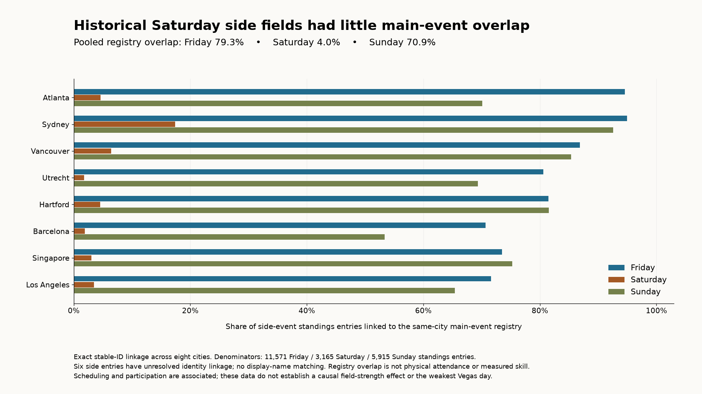

# Phase 6 — Competitive field composition and final recommendations

Research date: **2026-11-26**. Audience: attendees outside the invitational Vegas Regional Championship. This completes the authorized final research synthesis; no script, presentation, player-rating system or further research phase was started.

## Principal findings

**Historical scheduling is strongly associated with side-event composition.** Main-event registry overlap is **79.27% Friday, 3.98% Saturday and 70.85% Sunday**, and Saturday is lower in every city. Among main-linked Sunday entries, **4,048/4,191 (96.59%)** were below the published Day 2 gate. This supports the proposed participation mechanism. It does not prove that Saturday had weaker players or that Friday will be easiest in Vegas.

There are also descriptive performance differences: main-linked players won **60.07% of decisive cross-group matches Friday, 52.41% Saturday and 56.13% Sunday**. Opponents, selection, repeated players and formats differ. These fractions must not become measured player skill, a causal scheduling effect or assigned Vegas win probabilities.

Practical choices depend on the objective and starting balance. The equal-p50 mixed reference gives **11.93%** chance of 40 for **$135 / 19.5 occupied hours**; competitive-first gives **5.32% / $107.81 modeled entry spend / 19.73 hours**, but reserving its scheduled fallback exposes **$125** before any refunds, which are not assumed. Friday 2v2 expands the menu conditionally; it does not dominate all Friday alternatives. Near 40, small-event ceilings and guaranteed floors matter more than headline maximum prizes.

## Repository and preservation

The worktree was clean at the start. The conditional add-on is committed at **244515c**, after Phase 5 c596588; older “uncommitted” statements are historical status records. The new [manifest](../data/phase6/preserved_artifacts.json) protects **1,045 prior tracked files**. Authorized navigation/handoff/changelog and the general current-code validation inventory may update; prior raw captures, models, reports, tables, figures and execution logs remain protected. No commit or push is part of this task.

## 6A. Bounded feasibility and identity reliability

All eight official main events were located and their identities verified by official name, city and metadata:

| City | Main-event ID | Main roster rows | R8 standings | R13 standings |
|---|---:|---:|---:|---:|
| Atlanta | [502327](https://locator.riftbound.uvsgames.com/events/502327) | 1,832 | 1,832 | 1,832 |
| Sydney | [559231](https://locator.riftbound.uvsgames.com/events/559231) | 1,405 | 1,405 | 1,405 |
| Vancouver | [600265](https://locator.riftbound.uvsgames.com/events/600265) | 1,833 | 1,833 | 1,833 |
| Utrecht | [667904](https://locator.riftbound.uvsgames.com/events/667904) | 1,953 | 1,953 | 1,953 |
| Hartford | [683264](https://locator.riftbound.uvsgames.com/events/683264) | 1,954 | 1,953 | 1,954 |
| Barcelona | [857452](https://locator.riftbound.uvsgames.com/events/857452) | 2,224 | 2,224 | 2,224 |
| Singapore | [889532](https://locator.riftbound.uvsgames.com/events/889532) | 2,054 | 2,055 | 2,054 |
| Los Angeles | [889549](https://locator.riftbound.uvsgames.com/events/889549) | 2,165 | 2,165 | 2,165 |

The bounded collection adds metadata, **15,420 roster rows**, final Day 1 (R8) and final Swiss (R13) standings, and first-Day-2 (R9) pairings. No full main-event match history or elimination reconstruction was needed. All pagination groups are complete against their own advertised API counts. Snapshots, UTC retrieval times, URLs and hashes are isolated in [the source index](../data/phase6/sources.csv), [raw ledger](../data/raw/phase6/retrievals.jsonl) and `data/phase6/main_collections.json.gz`. Offline reading replays each copied row from its raw response.

Identifiers are positive integer platform user/player IDs, checked for agreement between standings identity fields and joined across the same city’s main registry. Display names never enter a join. Main roster and checkpoint identities are combined so a standings-only entry is not falsely called a non-main entrant. Within-event duplicate stable IDs were not found. Three main-event rows have conflicting identity fields (six identifier values quarantined); five side standings rows have conflicting fields. One additional side row encounters a main-identifier quarantine. **Six of 20,651 side rows (0.029%) remain unresolved.** No name matching or private identity research was attempted.

Three analytical groups remain distinct:

- **Main registry linked:** an exact, non-conflicting identifier occurs in the official main roster or Swiss checkpoints. This is entry evidence, not proof of a played physical match. Almost all have positive main record credits: 9,169/9,172 Friday, 124/126 Saturday, 4,190/4,191 Sunday.
- **Absent complete main registry:** a valid side identifier is absent from the complete captured main registry and checkpoints. This is confirmed registry absence under stable-ID/coverage assumptions. It does not establish that a person was a spectator, new, weak or absent under another account.
- **Unresolved identity:** missing/conflicting or quarantined identifier evidence. These rows remain in denominators; no zero or non-main classification is manufactured.

Hartford’s roster has 1,954 rows but R8 has 1,953; Singapore’s roster has 2,054 while R8 has 2,055. The discrepancies are retained and the registry union prevents false negatives. Historical Saturday record/placement anomalies from the conditional add-on remain unchanged. New analytical outputs contain no player names, stable person IDs, profiles or individual performance histories; immutable raw public evidence retains its original content.

### Participation and the main-event gate

The eight [official historical schedules](SOURCES.md) all specify eight Saturday Swiss rounds, an **18-match-point gate**, then five Sunday Swiss rounds. Qualification is calculated from round-specific R8 records, including credited byes and draws. It is a published-rule entitlement, distinct from observed R9 pairing participation. Drops do not automatically erase a qualifying record.

| Side-event day | Standings entries | Main linked | Absent complete main registry | Unresolved | Main-linked share |
|---|---:|---:|---:|---:|---:|
| Friday | 11,571 | 9,172 | 2,395 | 4 | 79.27% |
| Saturday | 3,165 | 126 | 3,039 | 0 | 3.98% |
| Sunday | 5,915 | 4,191 | 1,722 | 2 | 70.85% |

Every city has lower Saturday overlap than Friday and Sunday. Saturday ranges from **1.78% Utrecht to 17.42% Sydney**; do not erase the small-field Sydney exception. These are entry-weighted shares, not distinct attendees across events or cities. `phase6_side_overlap.csv` separately counts same-city Friday/Saturday/Sunday intersections, including how many also link to the main event.

Of the **4,191** main-linked Sunday entries, **4,048** were below the R8 gate and **143** met it; all have usable gate records. **142** appear in the first Day 2 pairings. The remaining qualified entry lacks that pairing evidence; no reason for nonparticipation is invented. Meeting the gate and appearing in a Day 2 pairing are separate observations. Sunday side selection is therefore largely consistent with the main event releasing nonqualifiers, while some qualified players also later entered a side event.



### Performance evidence and ticket entitlements

The strongest available comparison uses completed, explicitly resolved, two-person **Swiss matches within the same side event**, where one identifier is main-linked and the other absent from the complete main registry. Conflicts, byes, ghost matches, administrative/non-game losses, incomplete/unknown results and unresolved identities are excluded. Explicit draws remain separate. No elimination results or match-point guesses are substituted for played results.

| Day | Main-linked wins | Registry-absent wins | Draws | Main-linked share of decisive matches | Event-level range |
|---|---:|---:|---:|---:|---:|
| Friday | 4,702 | 3,125 | 115 | 60.07% | 57.6%–64.2% |
| Saturday | 283 | 257 | 29 | 52.41% | 40.6%–60.0% |
| Sunday | 2,925 | 2,286 | 105 | 56.13% | 52.8%–60.4% |

Friday and Sunday main-linked groups win more than half in each city’s cross-group sample. Saturday’s small selected main-linked group is mixed across cities (40.6–60.0%). These are census descriptions of the captured match subset, not independent observations from randomly assigned groups. Repeated players/rounds and differing opponent pools preclude a naive binomial significance claim or a causal field-strength interpretation. Historical RQ entry was open, while Vegas RC entry requires qualification; the categories are not interchangeable.

Aggregate performance distributions are preserved separately: `phase6_main_performance_distribution.csv` gives main R8 point bands and final-Swiss rank bands among each day’s side entrants; `phase6_side_performance_distribution.csv` gives side win-credit distributions by event and linkage group. `phase6_composition.csv` includes valid/missing records, W/L/D credits, match-evidenced entries and entitlement sums/bounds. Credits may include byes or administrative awards. R13 ranks are **Swiss rankings, not completed elimination placements**. Compare within the same event; different round counts/payout tables do not measure different skill.

| Day / group | Entries | Known entitlement sum | Unknown individual awards | Published mean or placement bounds |
|---|---:|---:|---:|---:|
| Friday / main linked | 9,172 | 103,397 | 0 | 11.273 |
| Friday / registry absent | 2,395 | 16,175 | 0 | 6.754 |
| Saturday / main linked | 126 | 1,932 | 1 | 16.476–18.762 |
| Saturday / registry absent | 3,039 | 31,812 | 26 | 12.363–12.458 |
| Sunday / main linked | 4,191 | 46,494 | 0 | 11.094 |
| Sunday / registry absent | 1,722 | 13,996 | 0 | 8.128 |

Friday/Sunday use existing primary record entitlements, including qualifying DROPPED entries. Saturday intervals conserve each event’s published Top 8 pool and known bracket evidence. Bounds for different groups are coupled and must not be treated as simultaneously attainable endpoints. Unresolved identities retain their own entitlement rows, rather than being discarded. None of these sums verifies physical issuance, actual split receipts or redemption.

### What changes in Vegas

The [official RC structure](https://playriftbound.com/en-us/news/organizedplay/north-american-regional-championship-info/) is six Friday Swiss rounds with ≥12 points advancing, six further Saturday rounds then Top 8 quarterfinals, and semifinals/final Sunday. Only four RC players remain in the Sunday championship bracket. This shifts the opportunity to enter side events earlier in the weekend relative to historical Saturday/Sunday RQs.

A reasonable mechanism is that active RC competitors are occupied Friday, Friday eliminations can free players for Saturday, and Saturday eliminations can free additional players for Sunday. **Availability is not attendance.** Friday early drops, booking cutoffs, other qualified attendees not playing RC, TFT competitors and self-selection can change actual fields. Rebound reserves 256 seats for RC competitors but does not establish that all reserved seats will be used. Rebound’s own successful players are occupied Sunday while Challenge starts, which is a separate selection effect. There is no defensible numerical forecast of RC side entries or ranking of Friday/Saturday/Sunday skill.

The [November 23 update](https://playriftbound.com/en-us/news/organizedplay/regional-championship-na-rules-update/) explicitly limits its changes to the NA RC. Do not apply its decklist/concession provisions automatically to side events. No RC-specific rules are used to simulate side-event performance.

## 6B. Practical recommendations

All numerical recommendations below use hypothetical p, not measured tiers of real people. No-draw references are convenient benchmarks; existing draw and format-performance sensitivities qualify them. Entry costs exclude passes, service fees, travel and decks. Included packs/promos are retained as products, not assigned monetary value. Published durations, 15-minute check-in/queue allowances, settlement timing and available seats/pods are assumptions.

| Attendee objective | Practical direction | Main limit |
|---|---|---|
| Equal-skill reference, primarily 40 tickets | Compare fixed mixed with the conditional adaptive benchmark; retain a budget and advance-booking plan | Neither makes 40 likely at p50; adaptive actions may not be available |
| Stronger hypothetical competitive player | Use p70 and separate format sensitivities; mixed still beats competitive-first when p70 is imposed everywhere | A genuine Rebound-specific advantage can reverse that ranking |
| Premier competitive experience | Choose Rebound for competition, not just ticket efficiency; commit to Sunday if qualified | Sunday Challenge overlaps and cannot be assumed available after elimination |
| Smaller events / Limited | Pick Sealed, Draft, Trial and Nexus for formats/products; optional ODEs fill time or gaps | The full casual-focused reference is a poor 40-from-zero grind, not a prescription to play every slot |
| Budget/time constrained | Sunday Challenge is the focused one-day $50 reference; small events help existing balances | 3.125% from zero at p50; Rebound uses both days if qualified |
| Considering Friday 2v2 | Bring a teammate and resolve fee/ownership terms; it replaces Friday Nexus | Equal allocation and $25/$50 per-person fee alternatives are hypothetical |
| Already near 40 | Start with the remaining gap, event ceiling/floor and available time | A small ceiling cannot fill a large gap even at 100% wins |

### Representative itineraries

| Reference / p | Friday / Saturday / Sunday | Modeled P(40+) | Selected entry spend | Occupied hours | Full plan exposure |
|---|---|---:|---:|---:|---:|
| Mixed /50% | Nexus /ODE + Trial + Nexus /Challenge | 11.93% | $135.00 | 19.50 | $135 |
| Mixed /70% | Nexus /ODE + Trial + Nexus /Challenge | 51.09% | $135.00 | 19.50 | $135 |
| Premier competition /50% | Nexus /Rebound /Rebound if qualified; Challenge otherwise | 5.32% | $107.81 | 19.73 | $125 |
| Formats/products /50% | Sealed + Nexus /ODE + Trial + Nexus /ODE + Sealed | 0.000715% | $195.00 | 20.75 | $195 |
| One-day Challenge /50% | — /— /Challenge | 3.12% | $50.00 | 7.75 | $50 |
| Friday team, $25/person scenario | 2v2 /ODE + Trial + Nexus /Challenge | 17.47% | $131.56 | 23.49 | $135 |
| Friday team, $50/person scenario | 2v2 /ODE + Trial + Nexus /Challenge | 17.47% | $156.56 | 23.49 | $160 |
| Adaptive benchmark /50% | Conditional finite-menu actions; not a fixed bookable itinerary | 18.84% | $175.64 | 21.16 | Unknown; $200 model cap |

The fixed mixed timing is Friday Nexus 18:30; Saturday Constructed ODE from11:00 (15-minute queue assumed), Champion Trial14:00 and Nexus18:30; Sunday Challenge11:00. The formats/products reference adds Friday Sealed11:00 and uses Sunday ODE11:00 plus Sealed14:00 instead of Challenge. The team variant uses Friday2v2 11:00–18:30 and the mixed Saturday/Sunday suffix. **It cannot also honor Nexus check-in at18:15**. These are illustrative menus, not instructions to grind when enjoyment is the objective. Exact dated-day offsets, check-in/queue starts, ends, costs and conditional branches are in `phase6_itinerary_events.csv`; all event clocks are **Las Vegas / America/Los_Angeles, Dec11–13,2026**.

The competitive-first selected-spend expectation of $107.81 assumes paying only for entered events. Securing both scheduled Rebound and Challenge fallback in advance exposes $125 with Friday Nexus. The model does not promise unused-ticket refunds, release after an early loss or a seat bought after elimination. The team scenarios have full-plan exposure of $135/$160, including a $10 ODE budget, versus $131.56/$156.56 selected-spend expectations. Scheduled booking exposure is $125/$150; the ODE purchase depends on actual pod entry. Mixed similarly has $125 scheduled booking plus $10 ODE budget. The separate columns are retained in the itinerary table. Adaptive’s $200 is its modeled resource/menu cap, not a verified price for reserving all possible mutually exclusive branches.

### Event objectives and sensitivity

`phase6_event_objectives.csv` compares expected tickets per entry dollar and **occupied** hour, ceilings, floors and products. These time rates include the assumed overhead; do not confuse them with old published-duration-only comparisons. At p50 Sunday Challenge has mean10.625 for $50 but only3.125% P40 from zero. Sealed has mean5 and a2-ticket floor, while Nexus has mean4 and an8-ticket ceiling. The highest mean-rate event need not be the best threshold or entertainment choice.

Friday 2v2 has a confirmed team payout table. At team p50 it averages11.875 per team. Hypothetical equal allocation gives5.9375/person and3.125% personal P40; the team-total40 chance is18.75%. Fee units and verified individual ticket ownership remain unresolved. Sealed plus Nexus instead averages9 personal tickets at $75 and6.5 occupied hours, versus the team’s7.75 hours and conditional personal mean. The team choice adds a personal high tail, but does not dominate mean tickets, time, spend or enjoyment. Team p is not inferred by multiplying individual p, and teammates share one Friday result.

Only five simple format-probability scenarios were added; the weekend optimizer was not rebuilt. At equal p50, mixed11.93% exceeds competitive-first5.32%. If only Rebound p rises to60% while other events remain50%, competitive-first becomes13.32% and overtakes mixed11.93%. If both competitive formats are40% with smaller events50%, mixed remains ahead5.35% versus1.43%. These are imposed sensitivities, never estimates derived from the registry data.

For a single $50 event, Rebound’s no-draw P40 matches Sunday Challenge p=50% at Rebound p≈49.7%; the exact search brackets it within0.01 percentage point. At Challenge p=60/70/80%, the Rebound break-even p is≈56.40/63.24/70.58%. This compares a different time commitment, not whole-weekend itineraries. The tiny p50 no-draw Rebound edge (3.2715% versus3.125%) also reverses in the **existing2% independent-draw sensitivity**:2.8167% Rebound versus2.8248% Challenge. These are not robust grounds for recommending two days of Rebound over a one-day Challenge solely to target40.

### Gap-aware choices

| Existing tickets | Gap | Useful single-event p50 comparisons | Implication |
|---:|---:|---|---|
|20|20|Sunday Challenge18.75%|Needs4+ wins for28+ tickets; casual/Trial/Sealed/Nexus single-event ceilings cannot fill20|
|25|15|Sunday Challenge50%|Three wins pay16; small casual ceiling still insufficient|
|30|10|Sunday Challenge50%|Same threshold band; a single Sealed or Nexus caps at8|
|35|5|Nexus31.25%, Sealed50%|Casual pod caps3 and Trial4; fee/time/products distinguish Nexus and Sealed|
|38|2|Casual pod50% ($10/2.5h); Trial87.5% ($25/2.75h); Sealed100% conditional ($50/3.25h)|Cheap chance versus higher-confidence supplement; Sealed’s floor is2|

At38, Draft ODE has the same three-round ticket ceiling as Constructed ODE but costs more and takes longer; choose it for drafting/product preference, not an invented ticket advantage. A two-ticket gap does not justify promising stock or redemption. Every option depends on which scheduled events remain and advance booking or pod availability. Full sensitivity rows for p50/70 and balances20/25/30/35/38 are in `phase6_close_to_40.csv`. Prior preserved all-weekend TFT ODE scenarios are **not** itinerary advice; verified TFT ODE availability begins Saturday noon.

### Operational check

Fresh official snapshots retain the same normalized33-row schedule and the same bytes of the previously reviewed October9 general tournament rules. The [official sign-up page](https://teamfighttactics.leagueoflegends.com/en-us/news/community/convergence-fest-side-events-and-the-encore-details/) requires a valid festival pass, Riot ID and advance Tixr purchase for scheduled events; ODE purchases are distinct. The vendor again returnedHTTP403, so actual stock, exact cutoffs and fee/allocation terms remain unverified. Programme closing times do not establish ODE last-launch rules. General conditional prize-sharing permission does not establish unrestricted cross-attendee ticket pooling, per-badge redemption rules or ticket ownership. The full confirmed/unresolved checklist is `phase6_operations.csv`. No organizers or players were contacted.

## 6C. Claim audit and production handoff

The authoritative [VIDEO_CLAIMS.md](VIDEO_CLAIMS.md) and `phase6_claims.csv` contain **57 claims across S01–S13**, with classifications, exact cell selectors/values, source reports, figures, official sources, assumptions, spoken/on-screen qualifications and supported/conditional/anecdotal/unresolved/contradicted status. Unresolved and contradicted claims are marked **DO_NOT_ASSERT**. This is a research claim index, not narration. No separate narration files were inspected or replaced.

Corrections to check against S01–S08: scope the title; keep counts/individual probabilities and totals/per-entrant means separate; use seven historical Swiss rounds; distinguish exact/tail probabilities and the high-p reversal; label hybrid rewards and the owner’s anecdote; keep sharing distinct from match draws; and acknowledge that casual ODEs already existed. S09 must retain lower absolute pooled success and nonuniform per-person unit effects. Historical independent sampling at eight gives62.18% pooled success and21.85-point pooling increment, versus finite-rank62.36%/21.82 points; the larger Vegas33.87-point increment survives this sensitivity.

[VIDEO_DATA_HANDOFF.md](VIDEO_DATA_HANDOFF.md) provides sequence-specific data columns, selectors, suggested comparisons, display rounding, visible assumptions and prohibited unsupported inferences. Reuse earlier figures; the single new PNG/SVG addresses the distinct composition finding. Recommendations are supplied as reusable data rather than additional graphics. No Remotion code or graphics redesign was implemented.

## Completion answers

1. **Does scheduling change composition?** The eight-city participation pattern strongly supports the hypothesized availability/selection mechanism. The historical comparison is descriptive and cannot identify a causal effect from scheduling alone.
2. **Participation or performance?** Both participation differences and selected within-event performance associations are observable. Neither establishes an overall skill ordering of fields or a rating system.
3. **Vegas Friday/Saturday/Sunday?** Active RC competitors are occupied earlier; successive eliminations can make more available. Rebound qualifiers are also occupied Sunday. Actual side entries and weakest/strongest days remain unknown.
4. **Robust recommendations?** Use objectives, gap ceilings/floors, time and booking constraints. The fixed mixed path leads the tested equal-format p50/p70 references; a Rebound-specific advantage can reverse it. A tiny standalone p40 edge is sensitive to p and draws.
5. **Friday2v2?** It materially expands the conditional personal high-tail menu and raises the equal-allocated mixed example from11.93% to17.47%, while costing more time and depending on fee/ownership terms. It is not a universal upgrade.
6. **Close to40?** Match the gap to a remaining event’s ceiling/floor. At38, a casual pod is a cheap chance, Trial is a higher chance and Sealed supplies a conditional2-ticket floor. At20–30, one small pod cannot bridge the gap.
7. **Which script claims need correction?** The S01–S08 checks and57-row index identify them. The separate draft narration was not inspected; this is not a claim that every line is audited.
8. **Strongest conclusions?** Lower matched-attendance Saturday chance/mean, reduced secured-cut upside, loss of the historical competitive ODE opportunity, larger first-threshold pooling increment despite lower absolute pooled success, and a strong historical composition pattern with qualified practical alternatives.
9. **What remains unresolved?** Causal field strength, actual Vegas entries, registration stock/deadlines, team fee/ownership, ODE operations, unrestricted ticket transfer/redemption restrictions, split frequency, issuance and inventory. A comprehensive historical whole-weekend decline is still unestablished.

The working title remains defensible **with explicit Saturday/premier-route scope in the opening and conclusion**. It is not supported as an unqualified causal statement that every Vegas attendee has a harder whole weekend. Production should retain that limitation rather than seek another research phase to force it.

## Reproducibility and validation

New outputs use `phase6_*`;20 focused machine tables include composition/linkage audits, performance distributions, qualification, cross-group matches, recommendations, itineraries, objectives, balance supplements, sensitivities, operations and the claim index. `data/phase6/production_inventory.json` is the sequence inventory. Original public raw bodies remain content-addressed and hash checked; analytical exports are aggregate only.

```sh
PYTHONPATH=src python3.12 -m riftbound_tickets.phase6 collect   # bounded public source retrieval
PYTHONPATH=src python3.12 -m riftbound_tickets.phase6 build
PYTHONPATH=src .venv-figures/bin/python -m riftbound_tickets.phase6 figures
PYTHONPATH=src python3.12 -m riftbound_tickets.phase6 audit
python3.12 scripts/validate_phase6.py
```

The isolated runner executes full unittest; legacy build, verify, audit and validate-pilot; Phase2/3A/3B/4/5 and conditional-performance audits; then Phase6 build/figures/audit. It preserves earlier execution records and stores actual exit codes, UTC timestamps and log hashes under `outputs/phase6/validation/` and `phase6_execution_validation.json`. Fresh results are recorded below after execution.

**Actually executed on 2026-11-26:** **192 tests passed and all14 recorded commands exited zero**. All **1,045 protected prior files** were unchanged before/after validation. The new1920×1080 composition figure was visually checked for readable labels, legends, denominators and uncertainty footnotes; PNG/SVG/input hashes passed. See [the execution report](../outputs/tables/phase6_execution_validation.json) and [artifact audit](../outputs/tables/phase6_validation.json), with UTC timestamps, exit codes and log hashes. Changes remain available for review; no commit or push occurred.
